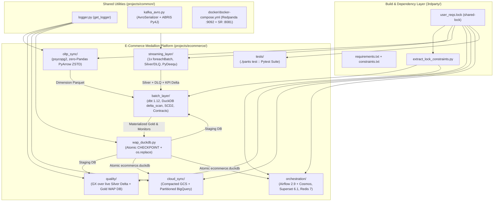
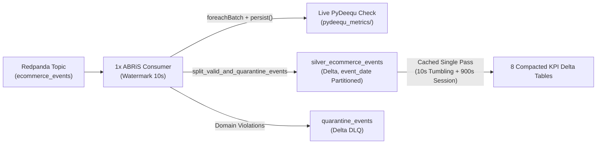
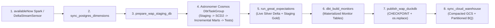

# System Architecture Overview

## 1. Monorepo Topology & Pants Build Graph

**`JayKay24/data-engineering`** is a **Python 3.10.9 Data Engineering Monorepo** managed by **Pantsbuild (v2.22.0)** with Python, Pytest, Docker, and Ruff backends enabled. All Python targets resolve against a single shared lockfile (`3rdparty/user_reqs.lock`) constrained by `3rdparty/constraints.txt`.

### Workspace Targets & Modules

| Module Path                              | Pants Targets                                  | Tech Stack                                            | Role in Platform                                                   |
| :--------------------------------------- | :--------------------------------------------- | :---------------------------------------------------- | :----------------------------------------------------------------- |
| **`3rdparty/`**                          | `:reqs`, `:lock_tools`, `:lock_files`          | Pants Lockfile, Python stdlib                         | Single source of truth for Python dependencies & Docker constraints |
| **`projects/common/`**                   | `:lib`                                         | `confluent-kafka[avro]`, PySpark Py4J, Redpanda       | Centralized logging, Avro/ABRiS helpers, Redpanda Docker stack     |
| **`projects/ecommerce/`**                | `:lib`, `:wap_duckdb`                          | `duckdb`                                              | Lock-resilient snapshot reader & atomic Write-Audit-Publish CLI    |
| **`projects/ecommerce/streaming_layer/`**| `:lib`, `:data_files`, `:producer`, `:stream_job`, `:quality_checks` | PySpark `3.5.8`, Delta `3.2.0`, ABRiS `6.4.0`, PyDeequ | Synthetic/file Avro producer, single-pass Silver/DLQ + tumbling KPIs |
| **`projects/ecommerce/oltp_sync/`**      | `:lib`, `:sync_dimensions`                     | `psycopg2-binary`, `pyarrow`                          | PostgreSQL 16 OLTP dimension seeding & zero-Pandas Parquet export  |
| **`projects/ecommerce/batch_layer/`**    | `:dbt_files`, `:dbt_image`                     | `dbt-duckdb`, DuckDB `1.5.6` (`delta` ext.), Docker   | `delta_scan()` staging, SCD2 snapshots, contracted incremental marts |
| **`projects/ecommerce/quality/`**        | `:lib`, `:validate`                            | `great-expectations`, `duckdb`, `pandas`              | Ephemeral GX suites validating live Silver Delta, DLQ & Gold marts |
| **`projects/ecommerce/cloud_sync/`**     | `:lib`, `:export`                              | `google-cloud-storage`, `google-cloud-bigquery`       | Compacted ZSTD GCS upload & partitioned/clustered BigQuery sync    |
| **`projects/ecommerce/orchestration/`**  | `:compose_files`, `:airflow_image`, `dags:dags`, `superset:package_assets`, `superset:superset_image` | Airflow `2.9.3`, Astronomer Cosmos, Postgres 16, Redis 7, Superset `6.1.0` | End-to-end Cosmos DAG, `duckdb_write_pool`, prod low-RAM stack, BI |
| **`projects/ecommerce/tests/`**          | `:tests`                                       | `pytest`, PySpark, DuckDB, dbtRunner                  | Hermetic unit & integration test suite (`./pants test ::`)         |
| **`infra/terraform/`**                   | —                                              | Terraform / OpenTofu (`hashicorp/google`)             | 7-day GCS lifecycle bucket, BigQuery tables & least-privilege IAM  |

---

## 2. Shared Platform Layer (`projects/common`)

### 2.1 Centralized Structured Logging (`logger.py`)
`get_logger(name)` enforces a unified log format (`YYYY-MM-DD HH:MM:SS [LEVEL] [logger_name] message`) over `stdout`, honoring `LOG_LEVEL` (default `INFO`) without duplicating root handlers across imported modules.

### 2.2 Redpanda Single-Binary Broker & ABRiS Py4J Bridge (`kafka_avro.py`)
- **Broker (`projects/common/docker/docker-compose.yml`)**: Single-source **Redpanda (`v24.2.11`)** definition capped at `350 MB` RAM, exposing both the Kafka wire protocol (`:9092` external / `:19092` internal) and Confluent-compatible Schema Registry (`:8081`) without ZooKeeper or JVM heap bloat. It can be started standalone or automatically via Compose `include:` in `projects/ecommerce/orchestration/docker-compose.yml`.
- **Producer Side (`create_avro_producer`)**: Pairs `SchemaRegistryClient` with `AvroSerializer` and `confluent_kafka.Producer` so events are validated against `ecommerce_event.avsc` prior to ingestion.
- **Consumer Side (`get_abris_from_avro_column`)**: Bridges PySpark to Scala ABRiS (`za.co.absa.abris`) via `spark._jvm`, downloading the latest reader schema by `TopicNameStrategy` from Schema Registry (`:8081`) and deserializing binary `value` bytes into structured Spark SQL columns.

---

## 3. Speed & Medallion Silver Layer (`streaming_layer`)

The Spark engine initializes with Delta Lake `optimizeWrite`/`autoCompact` enabled and four coordinated JVM Maven packages (plus Amazon Deequ):
- `org.apache.spark:spark-sql-kafka-0-10_2.12:3.5.8`
- `org.apache.spark:spark-avro_2.12:3.5.8`
- `za.co.absa:abris_2.12:6.4.0` (from `https://packages.confluent.io/maven/`)
- `io.delta:delta-spark_2.12:3.2.0` (with `DeltaSparkSessionExtension` & `DeltaCatalog`)
- `com.amazon.deequ:deequ` (via `pydeequ.deequ_maven_coord`, excluding `f2j_maven_coord`)

---

## 4. OLTP Sync, Batch Lakehouse & Atomic WAP (`oltp_sync`, `batch_layer`, `wap_duckdb.py`)

1. **Zero-Pandas OLTP Sync (`oltp_sync/sync_dimensions.py`)**: Uses `ThreadedConnectionPool` to upsert `dim_customers` and `dim_products` in PostgreSQL 16 and constructs typed `pyarrow.Table` objects directly for ZSTD Parquet export.
2. **ACID Delta Reads (`macros/get_stream_path.sql`)**: Uses DuckDB's native `delta` extension via `get_delta_path` (`delta_scan(...)`) for all Delta Lake tables so tombstoned Parquet files from overwrites or compaction are never read, while `get_parquet_path` (`read_parquet(...)`) reads Parquet-native dimensions and quality reports.
3. **dbt Materialization, SCD Type 2 & Contracts**:
   - `models/staging/` $\rightarrow$ `view` over `delta_scan()` and Parquet dimensions.
   - `snapshots/` $\rightarrow$ `snap_customers` and `snap_products` (`strategy='check'`, SCD Type 2).
   - `models/marts/` $\rightarrow$ incremental (`delete+insert`) & contract-enforced (`contract: {enforced: true}`) Gold tables inside `ecommerce_staging.duckdb`.
   - `models/monitors/` $\rightarrow$ materialized `table`s (`last_ingest`, `gx_quality_checks`, `pydeequ_quality_checks`, `quarantine_summary`) so the promoted serving DB is 100% self-contained.
4. **Atomic Write-Audit-Publish (`wap_duckdb.py`)**: Prepares `ecommerce_staging.duckdb` from `ecommerce.duckdb` before dbt/GX execution, and runs `CHECKPOINT;` + atomic `os.replace()` onto `ecommerce.duckdb` only after all quality gates pass.

---

## 5. Orchestration, Quality & Container Architecture

### 5.1 Airflow + Astronomer Cosmos DAG (`orchestration/dags/ecommerce_pipeline.py`)
Runs every 15 minutes (`*/15 * * * *`) using `LocalExecutor` backed by `postgres:16-alpine` and a single-slot `duckdb_write_pool` to serialize DuckDB writes across Cosmos subprocesses:

### 5.2 Lockfile-Pinned & Low-RAM Production Docker Builds
All Dockerfiles (`batch_layer/Dockerfile`, `orchestration/Dockerfile`, `orchestration/superset/Dockerfile`) are registered as Pants `docker_image` targets pinned to `3rdparty/user_reqs.lock` via `3rdparty/extract_lock_constraints.py`:
- `batch_layer/Dockerfile` pre-installs DuckDB CLI + `delta` extension.
- `orchestration/Dockerfile` bundles JRE 17 + Spark/Delta/PyDeequ inside `/opt/pipeline-venv` alongside `astronomer-cosmos` in Airflow `2.9.3`.
- `orchestration/docker-compose.yml` uses Compose `include:` to bring up `projects/common/docker/docker-compose.yml` (Redpanda `350 MB`) on the same shared network as Postgres, Redis, Airflow, and Superset. Layering the lean `orchestration/docker-compose.prod.yml` override (`-f docker-compose.yml -f docker-compose.prod.yml`) tunes Postgres (`128 MB`) and Redis (`64 MB`), sets `SPARK_IN_AIRFLOW=true`, restricts host port exposure, enables `SUPERSET_PUBLIC_READONLY=true`, and adds an optional `cloudflared` tunnel under ~2.6 GB RAM.
