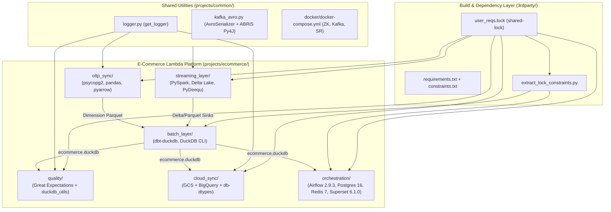
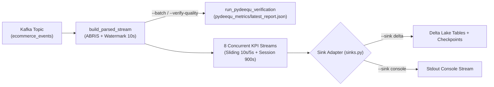
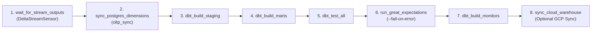

# System Architecture Overview

## 1. Monorepo Topology & Pants Build Graph

**`JayKay24/data-engineering`** is a **Python 3.10.9 Data Engineering Monorepo** managed by **Pantsbuild (v2.22.0)** with Python, Docker, and Ruff backends enabled. All Python targets resolve against a single shared lockfile (`3rdparty/user_reqs.lock`) constrained by `3rdparty/constraints.txt`.



### Workspace Targets & Modules

| Module Path                              | Pants Targets                                  | Tech Stack                                            | Role in Platform                                                   |
| :--------------------------------------- | :--------------------------------------------- | :---------------------------------------------------- | :----------------------------------------------------------------- |
| **`3rdparty/`**                          | `:reqs`, `:lock_tools`, `:lock_files`          | Pants Lockfile, Python stdlib                         | Single source of truth for Python dependencies & Docker constraints |
| **`projects/common/`**                   | `:lib`                                         | `confluent-kafka[avro]`, PySpark Py4J, Docker         | Centralized logging, Avro/ABRiS helpers, Kafka & SR containers     |
| **`projects/ecommerce/`**                | `:lib`                                         | `duckdb`                                              | Shared `connect_duckdb_readonly` lock-resilient snapshot helper    |
| **`projects/ecommerce/streaming_layer/`**| `:lib`, `:data_files`, `:producer`, `:stream_job`, `:quality_checks` | PySpark `3.5.8`, Delta `3.2.0`, ABRiS `6.4.0`, PyDeequ | Kafka Avro producer, Structured Streaming KPIs, Spark quality      |
| **`projects/ecommerce/oltp_sync/`**      | `:lib`, `:sync_dimensions`                     | `psycopg2-binary`, `pandas`, `pyarrow`                | PostgreSQL 16 OLTP dimension seeding & Parquet snapshot extraction |
| **`projects/ecommerce/batch_layer/`**    | `:dbt_files`, `:dbt_image`                     | `dbt-duckdb`, DuckDB `1.5.6`, Docker                  | SQL staging views, Gold analytical marts, freshness monitor        |
| **`projects/ecommerce/quality/`**        | `:lib`, `:validate`                            | `great-expectations`, `pandas`, `duckdb`              | Ephemeral GX suites validating raw JSON and Gold DuckDB marts      |
| **`projects/ecommerce/cloud_sync/`**     | `:lib`, `:export`                              | `google-cloud-storage`, `google-cloud-bigquery`, `db-dtypes` | Optional GCS Parquet upload & BigQuery Gold mart sync         |
| **`projects/ecommerce/orchestration/`**  | `:compose_files`, `:airflow_image`, `dags:dags`, `superset:package_assets`, `superset:superset_image` | Apache Airflow `2.9.3`, Postgres 16, Redis 7, Apache Superset `6.1.0`, `duckdb-engine` | Sensor-driven DAG scheduling and Dashboards-as-Code BI UI |

---

## 2. Shared Platform Layer (`projects/common`)

### 2.1 Centralized Structured Logging (`logger.py`)
`get_logger(name)` enforces a unified log format (`YYYY-MM-DD HH:MM:SS [LEVEL] [logger_name] message`) over `stdout`, honoring `LOG_LEVEL` (default `INFO`) without duplicating root handlers across imported modules.

### 2.2 Kafka Avro & ABRiS Py4J Bridge (`kafka_avro.py`)
- **Producer Side (`create_avro_producer`)**: Pairs `SchemaRegistryClient` with `AvroSerializer` and `confluent_kafka.Producer` so events are validated against `ecommerce_event.avsc` prior to Kafka ingestion.
- **Consumer Side (`get_abris_from_avro_column`)**: Bridges PySpark to Scala ABRiS (`za.co.absa.abris`) via `spark._jvm`, downloading the latest reader schema by `TopicNameStrategy` from Confluent Schema Registry (`:8081`) and deserializing binary `value` bytes into structured Spark SQL columns.

---

## 3. Speed Layer Architecture (`streaming_layer`)

The Spark engine initializes with four coordinated JVM Maven packages (plus Amazon Deequ when verification is active):
- `org.apache.spark:spark-sql-kafka-0-10_2.12:3.5.8`
- `org.apache.spark:spark-avro_2.12:3.5.8`
- `za.co.absa:abris_2.12:6.4.0` (from `https://packages.confluent.io/maven/`)
- `io.delta:delta-spark_2.12:3.2.0` (with `DeltaSparkSessionExtension` & `DeltaCatalog`)
- `com.amazon.deequ:deequ` (via `pydeequ.deequ_maven_coord`, excluding `f2j_maven_coord`)



---

## 4. OLTP Sync & Batch Lakehouse Layer (`oltp_sync` & `batch_layer`)

1. **OLTP Sync (`oltp_sync/sync_dimensions.py`)**: Uses a thread-safe `ThreadedConnectionPool` to upsert `dim_customers` and `dim_products` in PostgreSQL 16 and materialize Parquet files via `pyarrow`.
2. **Parquet Zero-Copy Bridge (`macros/get_stream_path.sql`)**: Both streaming Delta sinks and OLTP Parquet snapshots reside under `CLICK_STREAM_OUTPUT_PREFIX` (`output_data/`). Every dbt staging model resolves its source dynamically with:
   ```sql
   read_parquet('{{ env_var("CLICK_STREAM_OUTPUT_PREFIX", "/opt/project/output_data") }}/{{ table_name }}/*.parquet')
   ```
3. **dbt Materialization Strategy (`dbt_project.yml`)**:
   - `models/staging/` & `models/monitors/` $\rightarrow$ `view` (zero duplication over live Parquet).
   - `models/marts/` $\rightarrow$ `table` (materialized Gold tables inside `ecommerce.duckdb` for sub-second Superset BI queries and BigQuery exports).

---

## 5. Orchestration, Quality & Container Architecture

### 5.1 Airflow DAG (`orchestration/dags/ecommerce_pipeline.py`)
Runs every 15 minutes (`*/15 * * * *`) using `LocalExecutor` backed by `postgres:16-alpine`:



### 5.2 Lockfile-Pinned Docker Builds
All three Dockerfiles (`batch_layer/Dockerfile`, `orchestration/Dockerfile`, `orchestration/superset/Dockerfile`) are registered as Pants `docker_image` targets (`context_root = ""`, monorepo root) and work identically via `./pants package` or `make build`:
- `3rdparty/extract_lock_constraints.py` generates `/tmp/pants-constraints.txt` directly from `3rdparty/user_reqs.lock`.
- `batch_layer/Dockerfile` fetches the exact locked `duckdb` CLI binary (`v1.5.6`, `amd64` / `arm64`) alongside `dbt-core` and `dbt-duckdb`.
- `orchestration/Dockerfile` builds an isolated `/opt/pipeline-venv` with exact lockfile pins while keeping Airflow `2.9.3` core pinned to official Airflow constraints.
- `orchestration/superset/Dockerfile` extends `apache/superset:6.1.0`, installs `duckdb`, `duckdb-engine`, `psycopg2-binary` (pinned to `user_reqs.lock`), and `redis`, and bootstraps the Dashboards-as-Code bundle (`http://localhost:8088`).
