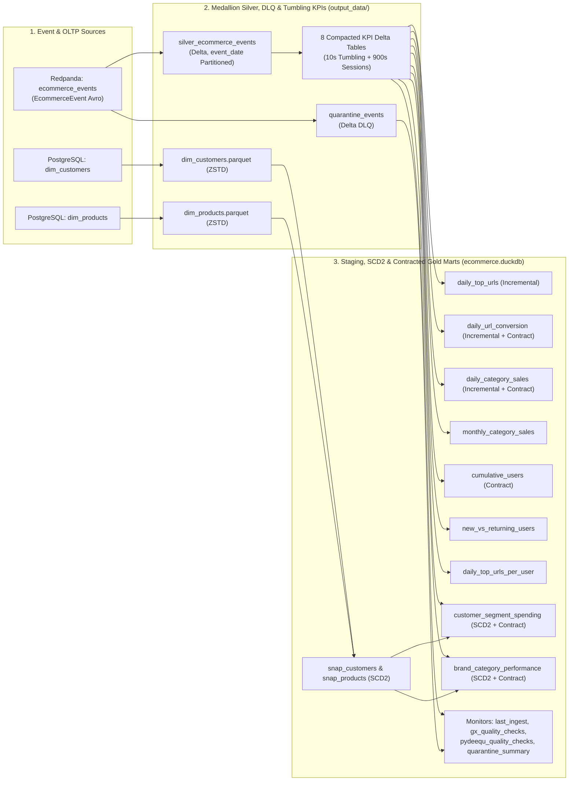

# Data Catalog & End-to-End Lineage

## 1. Executive Summary

This document serves as the **living data dictionary and lineage specification** for the E-Commerce [Medallion](Glossary#medallion-architecture) Lakehouse Platform (`projects/ecommerce`). It tracks every schema contract from raw [Avro](Glossary#avro) ingress and PostgreSQL [OLTP](Glossary#oltp) master tables through Medallion Silver/[DLQ](Glossary#dlq) [Delta](Glossary#delta-lake) tables, compacted [tumbling-window](Glossary#tumbling-window) [KPIs](Glossary#kpi), [dbt](Glossary#dbt) `delta_scan()` staging views, [SCD Type 2](Glossary#scd-type-2) snapshots, and contracted Gold DuckDB analytical marts.

---

## 2. End-to-End Data Lineage

---

## 3. Raw Event Contract (`EcommerceEvent` Avro Schema)

**File**: `projects/ecommerce/streaming_layer/schemas/ecommerce_event.avsc`  
**Namespace**: `com.dataengineering.realtime.ecommerce`

| Field Name   | Avro Type             | Nullable | Default | Description                                                     |
| :----------- | :-------------------- | :------: | :------ | :-------------------------------------------------------------- |
| `user_id`    | `string`              | No       | —       | Unique identifier of the user generating the event (Kafka key). |
| `url`        | `string`              | No       | —       | Web page URL visited by the user (e.g., `/products/laptop`).    |
| `event_type` | `string`              | No       | —       | Interaction type (`view`, `add_to_cart`, `purchase`).           |
| `event_time` | `string`              | No       | —       | ISO-8601 timestamp of the event occurrence.                     |
| `product_id` | `["null", "string"]`  | Yes      | `null`  | Product ID associated with the interaction.                     |
| `category`   | `["null", "string"]`  | Yes      | `null`  | Product category (e.g., `electronics`, `apparel`, `home`).      |
| `price`      | `["null", "double"]`  | Yes      | `null`  | Product unit price or transaction amount.                       |
| `ip_address` | `["null", "string"]`  | Yes      | `null`  | Client IP address.                                              |
| `user_agent` | `["null", "string"]`  | Yes      | `null`  | Client browser user agent string.                               |

---

## 4. PostgreSQL OLTP Dimension Tables (`oltp_sync/`)

**Source**: PostgreSQL 16 (`dim_customers`, `dim_products`) $\rightarrow$ exported directly via zero-Pandas `pyarrow.parquet` (ZSTD) to `output_data/dim_customers/` and `output_data/dim_products/`.

### 4.1 `dim_customers`
| Column              | Postgres Type | PyArrow / dbt Type | Description                                          |
| :------------------ | :------------ | :----------------- | :--------------------------------------------------- |
| `user_id`           | `VARCHAR(64)` | `string` / `varchar` | Primary key (`user_101`–`user_108`).                |
| `segment`           | `VARCHAR(64)` | `string` / `varchar` | Customer tier (`Enterprise`, `Consumer`, `SMB`).     |
| `region`            | `VARCHAR(64)` | `string` / `varchar` | Geographic market (`North America`, `Europe`, `Asia-Pacific`). |
| `registration_date` | `DATE`        | `string` / `date`    | Account creation date.                               |

### 4.2 `dim_products`
| Column       | Postgres Type    | PyArrow / dbt Type | Description                                   |
| :----------- | :--------------- | :----------------- | :-------------------------------------------- |
| `product_id` | `VARCHAR(64)`    | `string` / `varchar` | Primary key (`prod_01`–`prod_05`).          |
| `category`   | `VARCHAR(64)`    | `string` / `varchar` | Product category (`electronics`, `apparel`, `home`). |
| `brand`      | `VARCHAR(64)`    | `string` / `varchar` | Brand name (`ApexTech`, `StrideWear`, `CozyNest`, `NovaMobile`, `ErgoCraft`). |
| `unit_price` | `NUMERIC(10, 2)` | `float64` / `double` | Catalog unit price.                         |

---

## 5. Medallion Silver, Quarantine DLQ & KPI Delta Tables (`output_data/`)

All additive KPI sinks compute non-overlapping `10s` tumbling windows (`window_duration == slide_duration == "10 seconds"`) over `silver_ecommerce_events`; `session_funnels` uses dynamic `900s` session windows.

| Delta Table               | Partition / Key Columns                                   | Additional / Metric Columns                                                              |
| :------------------------ | :-------------------------------------------------------- | :--------------------------------------------------------------------------------------- |
| `silver_ecommerce_events` | Partitioned by `event_date` (`date`)                      | All validated `EcommerceEvent` columns + `ingested_at` (`timestamp`)                     |
| `quarantine_events`       | Unpartitioned DLQ                                         | Raw `EcommerceEvent` columns + `quarantine_reason` (`string`) + `ingested_at`            |
| `url_counts`              | `window_start`, `window_end`, `url`, `event_type`         | `count` (`long`)                                                                         |
| `user_counts`             | `window_start`, `window_end`, `user_id`                   | `total_events` (`long`)                                                                  |
| `url_conversion`          | `window_start`, `window_end`, `url`                       | `view_count`, `purchase_count`, `conversion_rate`                                        |
| `category_sales`          | `window_start`, `window_end`, `category`                  | `revenue` (`double`), `units` (`long`)                                                   |
| `product_sales`           | `window_start`, `window_end`, `user_id`, `product_id`, `category` | `revenue` (`double`), `units` (`long`)                                           |
| `cart_metrics`            | `window_start`, `window_end`, `url`                       | `view_count`, `add_to_cart_count`, `purchase_count`, `add_to_cart_rate`, `cart_abandonment` |
| `session_funnels`         | `session_start`, `session_end`, `user_id`                 | `has_view` (`bool`), `has_add` (`bool`), `has_purchase` (`bool`)                         |
| `top_urls_per_user`       | `window_start`, `window_end`, `user_id`, `url`            | `count` (`long`)                                                                         |

---

## 6. Batch Layer: dbt Staging Views, SCD2 Snapshots & Gold Marts (`ecommerce.duckdb`)

### 6.1 Staging Views (`models/staging/` — `materialized='view'`)

All Delta-backed staging views use `{{ get_delta_path('<table_name>') }}` (`delta_scan(...)` honoring `_delta_log`), while OLTP Parquet snapshots use `{{ get_parquet_path('<table_name>') }}`:

| Staging View              | Source Macro        | Tested Columns                                             |
| :------------------------ | :------------------ | :--------------------------------------------------------- |
| `silver_ecommerce_events` | `get_delta_path`    | `user_id`, `url`, `event_type` (`accepted_values`), `event_time` |
| `quarantine_events`       | `get_delta_path`    | `quarantine_reason`                                        |
| `cart_metrics`            | `get_delta_path`    | `url`, `window_start`                                      |
| `category_sales`          | `get_delta_path`    | `category`, `revenue`                                      |
| `product_sales`           | `get_delta_path`    | `user_id`, `product_id`, `revenue`                         |
| `session_funnels`         | `get_delta_path`    | `user_id`, `session_start`                                 |
| `top_urls_per_user`       | `get_delta_path`    | `user_id`, `url`                                           |
| `url_conversion`          | `get_delta_path`    | `url`, `conversion_rate`                                   |
| `url_counts`              | `get_delta_path`    | `url`, `event_type`                                        |
| `dim_customers`           | `get_parquet_path`  | `user_id`, `segment`                                       |
| `dim_products`            | `get_parquet_path`  | `product_id`, `brand`                                      |

### 6.2 SCD Type 2 Snapshots (`snapshots/` — `target_schema='snapshots'`)

- **`snap_customers`**: `unique_key='user_id'`, `strategy='check'`, `check_cols=['segment', 'region']`, `invalidate_hard_deletes=True`.
- **`snap_products`**: `unique_key='product_id'`, `strategy='check'`, `check_cols=['category', 'brand', 'unit_price']`, `invalidate_hard_deletes=True`.

### 6.3 Gold Analytical Marts (`models/marts/`)

| Gold Table                   | Materialization / Contract                  | Columns & Grain                                                                     |
| :--------------------------- | :------------------------------------------ | :---------------------------------------------------------------------------------- |
| `daily_category_sales`       | `incremental` (`delete+insert`) + Contract  | `sales_date` (`date`), `category` (`varchar`), `daily_revenue` (`double`), `daily_units` (`bigint`) |
| `monthly_category_sales`     | `table`                                     | `sales_month`, `category`, `monthly_revenue`, `monthly_units`                       |
| `daily_url_conversion`       | `incremental` (`delete+insert`) + Contract  | `conversion_date` (`date`), `url` (`varchar`), `total_views` (`bigint`), `total_purchases` (`bigint`), `avg_conversion_rate` (`double`) |
| `daily_top_urls`             | `incremental` (`delete+insert`)             | `activity_date`, `url`, `event_type`, `total_events`                                |
| `daily_top_urls_per_user`    | `table`                                     | `activity_date`, `user_id`, `url`, `total_visits`, `rank_num` ($\le 5$ per day/user)|
| `cumulative_users`           | `table` + Contract                          | `cohort_date` (`date`), `new_users` (`bigint`), `cumulative_users` (`bigint`)       |
| `new_vs_returning_users`     | `table`                                     | `activity_date`, `new_users`, `returning_users`, `total_active_users`               |
| `customer_segment_spending`  | `table` + SCD2 Join + Contract              | `user_id`, `segment`, `region`, `total_revenue`, `total_units`, `purchase_windows`  |
| `brand_category_performance` | `table` + SCD2 Join + Contract              | `brand`, `category`, `total_revenue`, `total_units`, `avg_unit_price`               |

### 6.4 Materialized Freshness & Quality Monitors (`models/monitors/` — `materialized='table'`)

Materialized as self-contained tables inside `ecommerce.duckdb` so atomic WAP promotion serves all Superset charts without external file dependencies:
- **`last_ingest`**: `latest_stream_window`, `batch_processed_at`, and `pipeline_latency`.
- **`gx_quality_checks`**: Materialized snapshot of `quality_reports/gx_checks.parquet`.
- **`pydeequ_quality_checks`**: Materialized snapshot of `pydeequ_metrics/pydeequ_checks.parquet`.
- **`quarantine_summary`**: Aggregated DLQ counts by `quarantine_reason` and `latest_quarantined_at` from `quarantine_events`.
