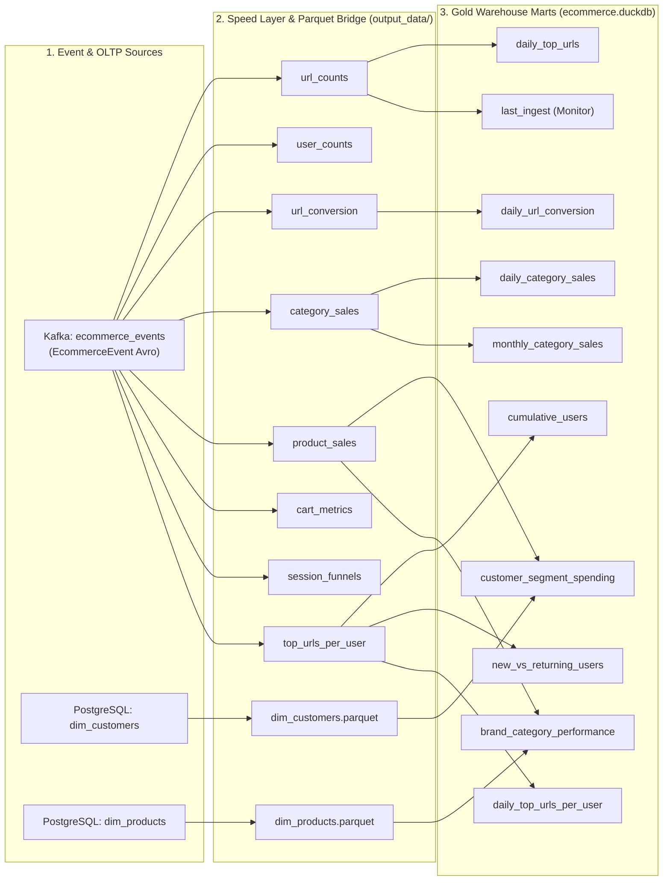

# Data Catalog & End-to-End Lineage

## 1. Executive Summary

This document serves as the **living data dictionary and lineage specification** for the E-Commerce Real-Time Lambda Architecture (`projects/ecommerce`). It tracks every schema contract from raw Avro ingress and PostgreSQL OLTP master tables through Delta Lake speed-layer sinks, dbt staging views, and Gold DuckDB analytical marts.

---

## 2. End-to-End Data Lineage

---

## 3. Raw Event Contract (`EcommerceEvent` Avro Schema)

**File**: `projects/ecommerce/streaming_layer/schemas/ecommerce_event.avsc`  
**Namespace**: `com.dataengineering.realtime.ecommerce`

| Field Name   | Avro Type             | Nullable | Default | Description                                                     |
| :----------- | :-------------------- | :------: | :------ | :-------------------------------------------------------------- |
| `user_id`    | `string`              | No       | —       | Unique identifier of the user generating the event (Kafka key). |
| `url`        | `string`              | No       | —       | Web page URL visited by the user (e.g., `/products/laptop`).    |
| `event_type` | `string`              | No       | —       | Interaction type (`view`, `add_to_cart`, `purchase`).           |
| `event_time` | `string`              | No       | —       | ISO-8601 timestamp of the event occurrence.                     |
| `product_id` | `["null", "string"]`  | Yes      | `null`  | Product ID associated with the interaction.                     |
| `category`   | `["null", "string"]`  | Yes      | `null`  | Product category (e.g., `electronics`, `apparel`, `home`).      |
| `price`      | `["null", "double"]`  | Yes      | `null`  | Product unit price or transaction amount.                       |
| `ip_address` | `["null", "string"]`  | Yes      | `null`  | Client IP address.                                              |
| `user_agent` | `["null", "string"]`  | Yes      | `null`  | Client browser user agent string.                               |

---

## 4. PostgreSQL OLTP Dimension Tables (`oltp_sync/`)

**Source**: PostgreSQL 16 (`dim_customers`, `dim_products`) $\rightarrow$ exported via `pyarrow` to `output_data/dim_customers/` and `output_data/dim_products/`.

### 4.1 `dim_customers`
| Column              | Postgres Type | Parquet / dbt Type | Description                                          |
| :------------------ | :------------ | :----------------- | :--------------------------------------------------- |
| `user_id`           | `VARCHAR(64)` | `varchar`          | Primary key (`user_101`–`user_108`).                  |
| `segment`           | `VARCHAR(64)` | `varchar`          | Customer tier (`Enterprise`, `Consumer`, `SMB`).     |
| `region`            | `VARCHAR(64)` | `varchar`          | Geographic market (`North America`, `Europe`, `Asia-Pacific`). |
| `registration_date` | `DATE`        | `date`             | Account creation date.                               |

### 4.2 `dim_products`
| Column       | Postgres Type    | Parquet / dbt Type | Description                                   |
| :----------- | :--------------- | :----------------- | :-------------------------------------------- |
| `product_id` | `VARCHAR(64)`    | `varchar`          | Primary key (`prod_01`–`prod_05`).            |
| `category`   | `VARCHAR(64)`    | `varchar`          | Product category (`electronics`, `apparel`, `home`). |
| `brand`      | `VARCHAR(64)`    | `varchar`          | Brand name (`ApexTech`, `StrideWear`, `CozyNest`, `NovaMobile`, `ErgoCraft`). |
| `unit_price` | `NUMERIC(10, 2)` | `double`           | Catalog unit price.                           |

---

## 5. Speed Layer Delta Lake Tables (`output_data/`)

All sliding-window sinks compute `10s` windows sliding every `5s` (`yyyy-MM-dd HH:mm:ss` string bounds); `session_funnels` uses dynamic `900s` session windows.

| Delta Table         | Key / Grouping Columns                           | Metric Columns                                                             |
| :------------------ | :----------------------------------------------- | :------------------------------------------------------------------------- |
| `url_counts`        | `window_start`, `window_end`, `url`, `event_type`| `count` (`long`)                                                           |
| `user_counts`       | `window_start`, `window_end`, `user_id`          | `total_events` (`long`)                                                    |
| `url_conversion`    | `window_start`, `window_end`, `url`              | `view_count`, `purchase_count`, `conversion_rate`                          |
| `category_sales`    | `window_start`, `window_end`, `category`         | `revenue` (`double`), `units` (`long`)                                     |
| `product_sales`     | `window_start`, `window_end`, `user_id`, `product_id`, `category` | `revenue` (`double`), `units` (`long`)                    |
| `cart_metrics`      | `window_start`, `window_end`, `url`              | `view_count`, `add_to_cart_count`, `purchase_count`, `add_to_cart_rate`, `cart_abandonment` |
| `session_funnels`   | `session_start`, `session_end`, `user_id`        | `has_view` (`bool`), `has_add` (`bool`), `has_purchase` (`bool`)           |
| `top_urls_per_user` | `window_start`, `window_end`, `user_id`, `url`   | `count` (`long`)                                                           |

---

## 6. Batch Layer: dbt Staging Views & Gold Marts (`ecommerce.duckdb`)

### 6.1 Staging Views (`models/staging/` — `materialized='view'`)

Every staging view reads live Parquet files via `{{ get_stream_path('<table_name>') }}` and applies explicit SQL type casts:

| Staging View        | Source Table        | Tested `not_null` Columns                   |
| :------------------ | :------------------ | :------------------------------------------ |
| `cart_metrics`      | `cart_metrics`      | `url`, `window_start`                       |
| `category_sales`    | `category_sales`    | `category`, `revenue`                       |
| `dim_customers`     | `dim_customers`     | `user_id`, `segment`                        |
| `dim_products`      | `dim_products`      | `product_id`, `brand`                       |
| `product_sales`     | `product_sales`     | `user_id`, `product_id`, `revenue`          |
| `session_funnels`   | `session_funnels`   | `user_id`, `session_start`                  |
| `top_urls_per_user` | `top_urls_per_user` | `user_id`, `url`                            |
| `url_conversion`    | `url_conversion`    | `url`, `conversion_rate`                    |
| `url_counts`        | `url_counts`        | `url`, `event_type`                         |

### 6.2 Gold Analytical Marts (`models/marts/` — `materialized='table'`)

| Gold Table                   | Upstream Sources                      | Columns & Grain                                                                     |
| :--------------------------- | :------------------------------------ | :---------------------------------------------------------------------------------- |
| `daily_category_sales`       | `category_sales`                      | `sales_date`, `category`, `daily_revenue`, `daily_units`                            |
| `monthly_category_sales`     | `category_sales`                      | `sales_month`, `category`, `monthly_revenue`, `monthly_units`                       |
| `daily_url_conversion`       | `url_conversion`                      | `conversion_date`, `url`, `total_views`, `total_purchases`, `avg_conversion_rate`   |
| `daily_top_urls`             | `url_counts`                          | `activity_date`, `url`, `event_type`, `total_events`                                |
| `daily_top_urls_per_user`    | `top_urls_per_user`                   | `activity_date`, `user_id`, `url`, `total_visits`, `rank_num` ($\le 5$ per day/user)|
| `cumulative_users`           | `top_urls_per_user`                   | `cohort_date`, `new_users`, `cumulative_users` (running window sum)                 |
| `new_vs_returning_users`     | `top_urls_per_user`                   | `activity_date`, `new_users`, `returning_users`, `total_active_users`               |
| `customer_segment_spending`  | `product_sales` $\bowtie$ `dim_customers` | `user_id`, `segment`, `region`, `total_revenue`, `total_units`, `purchase_windows` |
| `brand_category_performance` | `product_sales` $\bowtie$ `dim_products`  | `brand`, `category`, `total_revenue`, `total_units`, `avg_unit_price`              |

### 6.3 Freshness Monitor (`models/monitors/` — `materialized='view'`)

- **`last_ingest`**: Computes `latest_stream_window` (`max(window_end)` from `url_counts`), `batch_processed_at` (`current_timestamp`), and `pipeline_latency` (`age(current_timestamp, max(window_end))`).
