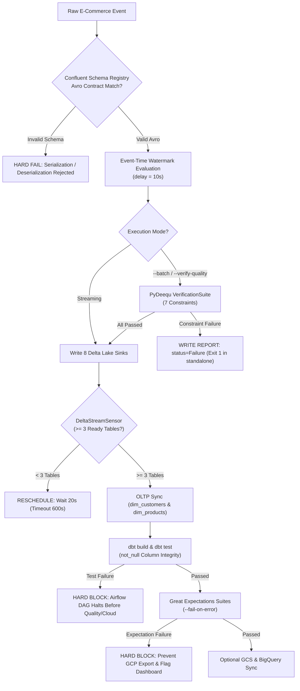

# Data Contracts, Windowing Math & Governance

## 1. Overview of Schema & Quality Governance

In a distributed Lambda Architecture, silent schema drift, out-of-order streaming events, and negative/null transactional values can corrupt downstream Gold marts without raising immediate runtime exceptions.

The platform centralizes governance across four enforcement boundaries:
1. **Ingress Contract Enforcement**: Confluent Schema Registry + ABRiS (`ecommerce_event.avsc`)
2. **Speed Layer Verification**: Amazon PyDeequ (`EcommerceEventsQualityCheck`)
3. **Batch Integrity Assertions**: dbt Schema Tests (`models/staging/schema.yml` & `models/marts/schema.yml`)
4. **Gold Warehouse Quality Gate**: Great Expectations Fluent API (`validate_ecommerce.py`)

---

## 2. End-to-End Governance Flow

---

## 3. Event-Time Windowing & KPI Mathematical Specification

### 3.1 Watermarking & Late-Event Handling

Every ingested event carries an ISO-8601 `event_time` string, which is cast to Spark `TIMESTAMP` (`to_timestamp(col("event_time"))`). To bound stateful memory while tolerating network jitter, Spark maintains a moving watermark with delay $\Delta_{\text{delay}} = 10\text{ seconds}$:

$$T_{\text{watermark}} = \max_{e \in \text{stream}}(t_{\text{event}}(e)) - 10\text{ seconds}$$

Any event arriving with $t_{\text{event}} < T_{\text{watermark}}$ is dropped by stateful window aggregations to guarantee deterministic window finalization in `append` output mode.

### 3.2 Sliding Window Assignment

For all sliding KPI aggregations (`url_counts`, `user_counts`, `url_conversion`, `category_sales`, `product_sales`, `cart_metrics`, `top_urls_per_user`), window duration is $W = 10\text{s}$ and slide interval is $S = 5\text{s}$. An event at timestamp $t$ belongs to every window $[w_{\text{start}}, w_{\text{start}} + W)$ aligned to multiples of $S$ where:

$$w_{\text{start}} \le t < w_{\text{start}} + 10\text{s}, \quad w_{\text{start}} = k \cdot 5\text{s} \;\; (k \in \mathbb{Z})$$

Each event therefore participates in $\frac{W}{S} = 2$ overlapping sliding windows.

### 3.3 Dynamic Session Window Merging

In `aggregate_session_funnels`, events for a given `user_id` are grouped dynamically using Spark's `session_window` with inactivity gap $\Delta_{\text{gap}} = 900\text{ seconds}$ (15 minutes). Two consecutive events $e_i, e_{i+1}$ for the same user belong to the same session if and only if:

$$t_{\text{event}}(e_{i+1}) - t_{\text{event}}(e_i) \le 900\text{ seconds}$$

Session bounds extend dynamically until no event arrives within 15 minutes past the latest observed timestamp, yielding boolean funnel flags (`has_view`, `has_add`, `has_purchase`).

### 3.4 Conversion & Cart Funnel Metrics

Within each window $w$ and page $u$, let $V_{u,w}$, $A_{u,w}$, and $P_{u,w}$ denote total `view`, `add_to_cart`, and `purchase` counts respectively:

- **URL Conversion Rate** (`aggregate_url_conversion`):
  $$\text{CR}(u, w) = \begin{cases} \text{round}\left(\dfrac{P_{u,w}}{V_{u,w}}, 4\right) & \text{if } V_{u,w} > 0 \\ 0.0 & \text{otherwise} \end{cases}$$

- **Add-to-Cart Rate** (`aggregate_cart_metrics`):
  $$\text{ATC}(u, w) = \begin{cases} \text{round}\left(\dfrac{A_{u,w}}{V_{u,w}}, 4\right) & \text{if } V_{u,w} > 0 \\ 0.0 & \text{otherwise} \end{cases}$$

- **Cart Abandonment Rate** (`aggregate_cart_metrics`):
  $$\text{Abandonment}(u, w) = \begin{cases} \text{round}\left(\dfrac{A_{u,w} - P_{u,w}}{A_{u,w}}, 4\right) & \text{if } A_{u,w} > 0 \\ 0.0 & \text{otherwise} \end{cases}$$

---

## 4. Governance & Quality Rules Matrix

| Governance Rule / Gate          | Layer               | Threshold / Constraint                                      | System Action                        | Override / Fallback Behavior                       |
| :------------------------------ | :------------------ | :---------------------------------------------------------- | :----------------------------------- | :------------------------------------------------- |
| **Avro Schema Conformance**     | Kafka / ABRiS       | Matches `EcommerceEvent` (`user_id`, `url`, `event_type`, `event_time` required) | **Hard Block** (Serialization error) | Schema evolution governed by Schema Registry `:8081` |
| **Dataset Non-Empty**           | PyDeequ (Spark)     | `hasSize > 0`                                               | **Error** (`status=Failure`)         | Standalone `quality_checks` exits `1`              |
| **Required Event Keys**         | PyDeequ & GX        | `user_id`, `url`, `event_type`, `event_time` non-null       | **Hard Block** (`--fail-on-error`)   | Halts Airflow DAG before Cloud Sync                |
| **Allowed Interaction Domain**  | PyDeequ & GX        | `event_type` $\in \{\text{view}, \text{add\_to\_cart}, \text{purchase}\}$ | **Hard Block** (`--fail-on-error`)   | Blocks invalid interaction states from Gold marts  |
| **Non-Negative Pricing**        | PyDeequ (Spark)     | `price >= 0` (null permitted on non-purchase views)         | **Error** (`status=Failure`)         | Audited in `pydeequ_metrics/latest_report.json`    |
| **Gold Revenue & Units**        | Great Expectations  | `daily_revenue >= 0`, `daily_units >= 0`, `total_revenue >= 0` | **Hard Block** (`--fail-on-error`)   | Prevents negative revenue propagation to BigQuery  |
| **Conversion Rate Bounds**      | Great Expectations  | $0.0 \le \text{avg\_conversion\_rate} \le 1.0$              | **Hard Block** (`--fail-on-error`)   | Catches anomaly spikes when views are undercounted |
| **dbt Column Integrity**        | dbt Batch Layer     | `not_null` across staging keys & enriched mart dimensions   | **Hard Block** (`dbt test` failure)  | Blocks `run_great_expectations` in Airflow DAG     |
| **Stream Readiness Quorum**     | Airflow Sensor      | $\ge 3$ sink tables with `_delta_log/*.json` or `*.parquet` | **Reschedule** (20s interval, 600s max) | Prevents empty-table dbt failures on cold start    |

---

## 5. Six Core Operational Verification Scenarios

### 1. The Late-Arriving Mobile Checkout
- **Context**: A mobile shopper loses connectivity in a tunnel after clicking `/checkout` (`purchase`) and reconnects 7 seconds later; the event arrives out of order relative to newer `/home` views.
- **Resolution**: Because $7\text{s} \le \Delta_{\text{delay}}$ (`10 seconds`), the event falls inside Spark's watermark window. Spark updates the open `10s` sliding window and `900s` session funnel state before committing the finalized Delta sink row.

### 2. The Schema Evolution Mismatch
- **Context**: An upstream producer emits an event missing required `event_time` or carrying a string in the `price` (`["null", "double"]`) field.
- **Resolution**: `AvroSerializer` in `create_avro_producer` validates the payload against `ecommerce_event.avsc` and Confluent Schema Registry before writing to Kafka, rejecting malformed records at the source rather than breaking downstream PySpark or dbt casts.

### 3. The Concurrent DuckDB Reader Lock
- **Context**: An engineer has `ecommerce.duckdb` open in DBeaver or Streamlit while the Airflow `run_great_expectations` or `sync_cloud_warehouse` task attempts to validate or export Gold marts.
- **Resolution**: `connect_duckdb_readonly` catches `duckdb.IOException ("Could not set lock")`, copies `ecommerce.duckdb` (and `.wal` if present) into an isolated `tempfile.TemporaryDirectory()`, and opens a clean read-only connection on the snapshot without failing the pipeline.

### 4. The Cold-Start Stream Delay
- **Context**: The Airflow `ecommerce_batch_refresh` DAG triggers on schedule immediately after infrastructure boot before Spark has committed all Delta Lake tables.
- **Resolution**: `DeltaStreamSensor` polls `output_data/` for `_delta_log/*.json` or `*.parquet` across configured sinks. Until at least `min_ready_tables=3` exist, Airflow releases the worker slot via `mode="reschedule"` every 20 seconds instead of blocking worker concurrency or failing `dbt build`.

### 5. The Corrupt Price Injection
- **Context**: A faulty upstream replay injects `price = -49.99` on a `purchase` event.
- **Resolution**: In Spark batch verification (`quality_checks.py`), PyDeequ's `.isNonNegative("price")` fails and records the violating constraint in `pydeequ_metrics/latest_report.json`. If propagated to DuckDB, Great Expectations `ExpectColumnValuesToBeBetween(column="daily_revenue", min_value=0)` halts the Airflow DAG before `sync_cloud_warehouse` executes.

### 6. The Offline Local Developer Run
- **Context**: A developer clones the repo locally without Docker Postgres running and without GCP service account credentials configured.
- **Resolution**: Running `oltp_sync:sync_dimensions -- --seed-from-defaults-on-offline` catches `psycopg2.OperationalError` and writes baseline Parquet dimensions (`8` customers, `5` products), while `cloud_sync:export` defaults to `GCP_SYNC_ENABLED=false`, logs a dry-run inventory of local Parquet artifacts and DuckDB marts, and exits `0`.
