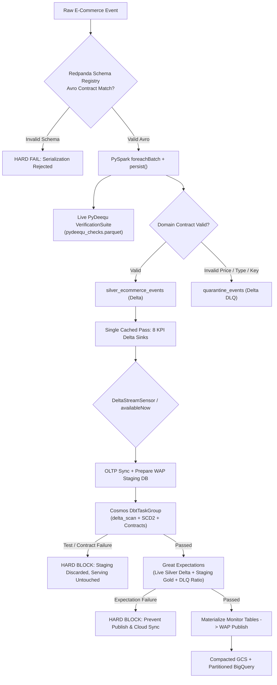

# Data Contracts, Windowing Math & Governance

## 1. Overview of Schema & Quality Governance

The platform enforces schema contracts, mathematical exactness, and operational isolation across five layers:
1. **Ingress Contract Enforcement**: Redpanda Schema Registry (`:8081`) + Avro (`ecommerce_event.avsc`) + ABRiS.
2. **Micro-Batch Speed Verification & Quarantine DLQ**: Live Amazon PyDeequ inside `foreachBatch` + `split_valid_and_quarantine_events` routing domain violations to `quarantine_events`.
3. **Batch Schema & Model Contracts**: dbt `1.12` schema tests, enforced `contract: {enforced: true}`, and SQL unit tests (`unit_tests.yml`).
4. **Live Silver & Gold Warehouse Gate**: Great Expectations Fluent API (`validate_ecommerce.py`) validating live `silver_ecommerce_events` via DuckDB `delta_scan()`, quarantine ratio bounds, and Gold marts.
5. **Atomic Write-Audit-Publish (WAP)**: All dbt/GX writes target `ecommerce_staging.duckdb` and promote atomically (`CHECKPOINT;` + `os.replace()`) to `ecommerce.duckdb`.

---

## 2. End-to-End Governance Flow

---

## 3. Event-Time Windowing & KPI Mathematical Specification

### 3.1 Watermarking & Late-Event Handling

Every ingested event carries an ISO-8601 `event_time` string, cast to Spark `TIMESTAMP` (`to_timestamp(col("event_time"))`). Spark maintains a moving watermark with delay $\Delta_{\text{delay}} = 10\text{ seconds}$:

$$T_{\text{watermark}} = \max_{e \in \text{stream}}(t_{\text{event}}(e)) - 10\text{ seconds}$$

Events arriving within $10\text{ seconds}$ of the watermark are incorporated into window state; events older than $T_{\text{watermark}}$ are dropped by stateful streaming aggregations.

### 3.2 Non-Overlapping Tumbling Window Assignment

For all additive KPI aggregations (`url_counts`, `user_counts`, `url_conversion`, `category_sales`, `product_sales`, `cart_metrics`, `top_urls_per_user`), window duration $W = 10\text{s}$ equals slide interval $S = 10\text{s}$:

$$w_{\text{start}} \le t < w_{\text{start}} + 10\text{s}, \quad w_{\text{start}} = k \cdot 10\text{s} \;\; (k \in \mathbb{Z})$$

Each validated event therefore belongs to **exactly one** window ($\frac{W}{S} = 1$), guaranteeing that downstream Gold rollups (`SUM(revenue)`, `SUM(units)`) reflect exact transactional totals without double-counting.

### 3.3 Dynamic Session Window Merging

In `aggregate_session_funnels`, events for a given `user_id` are grouped dynamically using `session_window` with inactivity gap $\Delta_{\text{gap}} = 900\text{ seconds}$ (15 minutes):

$$t_{\text{event}}(e_{i+1}) - t_{\text{event}}(e_i) \le 900\text{ seconds}$$

### 3.4 Conversion & Cart Funnel Metrics

Within each window $w$ and page $u$, let $V_{u,w}$, $A_{u,w}$, and $P_{u,w}$ denote `view`, `add_to_cart`, and `purchase` counts respectively:

- **URL Conversion Rate**: $\text{CR}(u, w) = \text{round}(P_{u,w} / V_{u,w}, 4)$ when $V_{u,w} > 0$, else $0.0$.
- **Add-to-Cart Rate**: $\text{ATC}(u, w) = \text{round}(A_{u,w} / V_{u,w}, 4)$ when $V_{u,w} > 0$, else $0.0$.
- **Cart Abandonment Rate**: $\text{Abandonment}(u, w) = \text{round}((A_{u,w} - P_{u,w}) / A_{u,w}, 4)$ when $A_{u,w} > 0$, else $0.0$.

---

## 4. Governance & Quality Rules Matrix

| Governance Rule / Gate          | Layer               | Threshold / Constraint                                      | System Action                        | Override / Fallback Behavior                       |
| :------------------------------ | :------------------ | :---------------------------------------------------------- | :----------------------------------- | :------------------------------------------------- |
| **Avro Schema Conformance**     | Redpanda / ABRiS    | Matches `EcommerceEvent` (`user_id`, `url`, `event_type`, `event_time` required) | **Hard Block** (Serialization error) | Schema evolution governed by Schema Registry `:8081` |
| **Micro-Batch Verification**    | PyDeequ (`foreachBatch`) | `hasSize > 0`, completeness, allowed `event_type`, `price >= 0` | **Audit + Log** (`pydeequ_checks.parquet`) | Bad rows routed to DLQ instead of halting stream |
| **Quarantine DLQ Routing**      | Spark Medallion     | Null keys, invalid `event_type`, or `price < 0`             | **Quarantine** (`quarantine_events`) | Annotated with `quarantine_reason` for monitoring  |
| **dbt Model Contracts & Tests** | dbt Batch Layer     | Enforced column `data_type`s + `not_null` / `accepted_values` | **Hard Block** (`dbt` failure)       | Staging DuckDB never promoted to serving           |
| **Live Silver & Gold Gate**     | Great Expectations  | Live `silver_ecommerce_events`, quarantine ratio $\le 0.5$, Gold bounds | **Hard Block** (`--fail-on-error`)   | Halts before WAP publish and Cloud Sync            |
| **Atomic WAP Promotion**        | `wap_duckdb.py`     | `CHECKPOINT;` + `os.replace()` after all tests/GX pass      | **Atomic Swap** (`ecommerce.duckdb`) | Serving readers never encounter partial/locked DB  |

---

## 5. Six Core Operational Verification Scenarios

### 1. The Late-Arriving Mobile Checkout
- **Context**: A mobile shopper reconnects 7 seconds late (`--late-event-ratio` in synthetic producer).
- **Resolution**: Because $7\text{s} \le \Delta_{\text{delay}}$ (`10 seconds`), Spark incorporates the event into the open `10s` tumbling window and `900s` session funnel state before writing Silver and KPI Delta sinks.

### 2. The Schema Evolution Mismatch
- **Context**: An upstream producer emits an event missing required `event_time` or carrying an invalid field type.
- **Resolution**: `AvroSerializer` validates against `ecommerce_event.avsc` and Redpanda Schema Registry `:8081`, rejecting malformed payloads at ingress.

### 3. The Concurrent DuckDB Reader & WAP Isolation
- **Context**: Apache Superset serves live dashboard queries while Airflow runs `dbt build` and Great Expectations every 15 minutes.
- **Resolution**: Airflow writes exclusively to `ecommerce_staging.duckdb` (serialized via `duckdb_write_pool`), then executes `CHECKPOINT;` and `os.replace()` onto `ecommerce.duckdb`, while Superset refreshes cleanly via `pool_recycle=30s` and `connect_duckdb_readonly` protects CLI tools.

### 4. The Cold-Start Stream Delay
- **Context**: Airflow triggers before Spark commits Delta outputs.
- **Resolution**: In `SPARK_IN_AIRFLOW=true` mode, Airflow runs `stream_job --mode available-now` directly upstream; otherwise `DeltaStreamSensor` polls in `reschedule` mode until `min_ready_tables=3` Delta logs exist.

### 5. The Corrupt Price or Invalid Event Injection
- **Context**: Synthetic traffic (`--anomaly-ratio 0.1`) or an upstream bug injects `price = -49.99` or `event_type = "refund_err"`.
- **Resolution**: PyDeequ records the anomaly inside `foreachBatch`, `split_valid_and_quarantine_events` isolates the row in `quarantine_events` (keeping `silver_ecommerce_events` and Gold revenue clean), and Great Expectations enforces the maximum quarantine ratio (`--max-quarantine-ratio`) before WAP publish.

### 6. The Offline Local Developer Run
- **Context**: Running locally without Postgres or GCP credentials.
- **Resolution**: `oltp_sync:sync_dimensions -- --seed-from-defaults-on-offline` emits baseline ZSTD Parquet dimensions (`8` customers, `5` products), and `cloud_sync:export` logs a dry-run inventory of compacted Gold Parquet exports and exits `0`.
