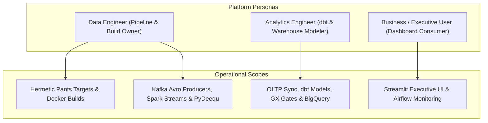

# E-Commerce Data Platform Requirements Specification

## 1. Executive Summary & Vision

The **E-Commerce Real-Time Lambda Architecture Platform** (`projects/ecommerce`) provides unified operational and analytical intelligence over high-velocity e-commerce clickstream and purchase activity. Real-time digital storefronts emit heterogeneous events (`view`, `add_to_cart`, `purchase`) with optional product metadata and out-of-order mobile delivery.

The platform bridges low-latency stream processing with ACID-compliant batch warehousing by pairing:
- A **Speed Layer** (Kafka + Confluent Schema Registry + PySpark Structured Streaming + ABRiS + PyDeequ + Delta Lake) for continuous event-time KPIs.
- An **OLTP Dimension Sync Layer** (PostgreSQL 16 + `psycopg2-binary` + PyArrow) for customer and product master data enrichment.
- A **Batch Warehouse Layer** (dbt + DuckDB) for curated Silver/Gold dimensional marts and freshness monitoring.
- A **Quality & Cloud Governance Layer** (Great Expectations + Google Cloud Storage + BigQuery) and an **Orchestration & Serving Layer** (Apache Airflow 2.9.3 + Streamlit + Plotly).

---

## 2. Platform Stakeholders & Functional Scopes

### 2.1 Data Engineer
- **Hermetic Execution**: Execute every pipeline entry point as a reproducible Pants `pex_binary` (`./pants run ...`) locked to Python `3.10.9` and `3rdparty/user_reqs.lock`.
- **Container Parity**: Build Docker images (`dbt_image`, `airflow_image`, `viz_image`) constrained to exact Pants lockfile versions via `3rdparty/extract_lock_constraints.py`.
- **Stream Governance**: Enforce Avro schema contracts in Confluent Schema Registry (`:8081`) and verify bounded datasets with Amazon PyDeequ.

### 2.2 Analytics Engineer
- **Dynamic Lakehouse Pathing**: Resolve Delta/Parquet output directories dynamically via the `get_stream_path` dbt macro and `CLICK_STREAM_OUTPUT_PREFIX`.
- **Dimensional Enrichment**: Join streaming `product_sales` against synced PostgreSQL `dim_customers` (`segment`, `region`) and `dim_products` (`brand`, `unit_price`) without coupling streaming Spark jobs to OLTP read queries.
- **Automated Testing**: Enforce column integrity (`not_null`) via `dbt test` and Gold warehouse assertions via Great Expectations.

### 2.3 Business & Executive Stakeholder
- **Real-Time KPI Monitoring**: Inspect Total Revenue, Units Sold, Cumulative Users, and Average Conversion Rate at `http://localhost:8501`.
- **Customer & Brand Analytics**: Slice purchase performance across customer segments, geographic regions, and product brands.
- **Pipeline Trust & Freshness**: Verify data recency (`last_ingest`) and live PyDeequ / Great Expectations pass rates directly in the dashboard.

---

## 3. Speed Layer Requirements (`streaming_layer/`)

### 3.1 Avro Schema Governance & Event Ingestion
- **Producer (`ecommerce_producer.py`)**: Reads line-delimited JSON events (`input_data/ecommerce_events.json`), serializes payloads with `AvroSerializer` against `schemas/ecommerce_event.avsc`, keys messages by `user_id`, and publishes to Kafka topic `ecommerce_events` (`localhost:9092`) with delivery callback logging.
- **Consumer (`ecommerce_aggregation_job.py`)**: Connects to Kafka (`startingOffsets: earliest`, `failOnDataLoss: false`), deserializes Confluent Avro binary payloads dynamically via `get_abris_from_avro_column` (ABRiS `6.4.0` Py4J bridge), casts `event_time` to `TIMESTAMP`, and applies a `10 seconds` watermark.

### 3.2 Stateful Aggregations (`aggregations.py`)
The Spark engine must compute **8 concurrent KPI aggregations**:
1. **`url_counts`**: Sliding window (`10s` duration / `5s` slide) event counts grouped by `url` and `event_type`.
2. **`user_counts`**: Sliding window activity counts grouped by `user_id`.
3. **`url_conversion`**: Pivoted `view` vs. `purchase` counts per `url` with `conversion_rate = round(purchase / view, 4)`.
4. **`category_sales`**: Purchase-only revenue and unit volume grouped by `category`.
5. **`product_sales`**: Purchase-only revenue and unit volume preserving `user_id`, `product_id`, and `category` keys for OLTP dimensional joins.
6. **`cart_metrics`**: Pivoted `view`, `add_to_cart`, and `purchase` counts computing `add_to_cart_rate` and `cart_abandonment`.
7. **`top_urls_per_user`**: Base `user_id` + `url` visit counts per window for Top-N ranking in the batch layer.
8. **`session_funnels`**: `15-minute` (`900 seconds`) session windows per `user_id` tracking funnel progression flags (`has_view`, `has_add`, `has_purchase`).

### 3.3 Dual Execution Modes & ACID Sinks (`sinks.py`)
- **Streaming Mode (`--sink delta` or `--sink console`)**: Writes continuous micro-batches (`trigger: 5 seconds`, `output_mode: append`) with per-sink checkpoint directories (`projects/ecommerce/checkpoints/delta_<name>`).
- **Batch Mode (`--batch`)**: Evaluates bounded Kafka input, executes `run_pydeequ_verification`, and overwrites Delta Lake tables in a single pass.

---

## 4. OLTP Dimension Sync Requirements (`oltp_sync/`)

- **Connection Pooling (`config.py`)**: Maintain a thread-safe `ThreadedConnectionPool` singleton (`minconn=1`, `maxconn=5`) initialized via `POSTGRES_HOST`, `POSTGRES_PORT`, `POSTGRES_DB`, `POSTGRES_USER`, and `POSTGRES_PASSWORD` with transactional commit/rollback context management (`get_connection()`).
- **Idempotent Seeding & Extraction (`sync_dimensions.py`)**:
  - Create `dim_customers` and `dim_products` tables if absent and upsert baseline records via `ON CONFLICT (...) DO UPDATE`.
  - Extract dimension tables into Pandas DataFrames and write Parquet snapshots (`output_data/dim_customers/dim_customers.parquet` and `output_data/dim_products/dim_products.parquet`) using `pyarrow`.
  - Support `--seed-from-defaults-on-offline` so standalone local runs succeed when PostgreSQL is offline.

---

## 5. Batch Layer & Gold Warehouse Requirements (`batch_layer/`)

- **Engine**: DuckDB (`ecommerce.duckdb`) driven by `dbt-duckdb` (`4` threads).
- **Staging Views (`models/staging/`)**: Materialize 9 non-persisted views (`cart_metrics`, `category_sales`, `dim_customers`, `dim_products`, `product_sales`, `session_funnels`, `top_urls_per_user`, `url_conversion`, `url_counts`) with explicit type casts and `not_null` column tests.
- **Gold Analytical Marts (`models/marts/`)**: Materialize 9 persisted tables covering category sales (`daily_category_sales`, `monthly_category_sales`), URL funnels (`daily_url_conversion`, `daily_top_urls`, `daily_top_urls_per_user`), user cohorts (`cumulative_users`, `new_vs_returning_users`), and OLTP-enriched marts (`customer_segment_spending`, `brand_category_performance`).
- **Freshness Monitor (`models/monitors/last_ingest.sql`)**: Expose `latest_stream_window`, `batch_processed_at`, and `pipeline_latency` for observability.

---

## 6. Data Quality & Cloud Sync Requirements (`quality/`, `cloud_sync/`)

- **Spark Layer Quality (`streaming_layer/quality_checks.py`)**: Validate bounded Spark DataFrames with Amazon PyDeequ (`hasSize > 0`, `isComplete`, `isContainedIn`, `isNonNegative("price")`) and write `output_data/pydeequ_metrics/latest_report.json`.
- **Warehouse Quality (`quality/validate_ecommerce.py`)**: Run Great Expectations (`ephemeral` context) across raw JSON events and Gold DuckDB marts (`daily_category_sales`, `daily_url_conversion`, `customer_segment_spending`), persisting `output_data/quality_reports/gx_validation_results.json` and failing non-zero when `--fail-on-error` is enabled.
- **Optional GCP Lakehouse Sync (`cloud_sync/export_to_gcp.py`)**: When `GCP_SYNC_ENABLED=true`, upload local Parquet artifacts to Google Cloud Storage (`gs://<GCS_BUCKET>/ecommerce/curated/...`), truncate-load 5 Gold marts into BigQuery (`<GCP_PROJECT>.<BIGQUERY_DATASET>`), and run a BigQuery verification query (`to_dataframe()` via `db-dtypes`). When disabled, log a structured dry-run inventory and exit `0`.

---

## 7. Orchestration & Executive BI Requirements (`orchestration/`)

- **Sensor-Driven Airflow DAG (`ecommerce_batch_refresh`)**: Scheduled every 15 minutes (`*/15 * * * *`, `catchup=False`), beginning with `DeltaStreamSensor` (`min_ready_tables=3`, `poke_interval=20s`, `timeout=600s`, `mode="reschedule"`) before executing OLTP sync $\rightarrow$ dbt staging $\rightarrow$ dbt marts $\rightarrow$ `dbt test` $\rightarrow$ Great Expectations $\rightarrow$ GCP cloud sync.
- **Streamlit Dashboard (`viz/app.py`)**: Expose 4 top-level KPI cards and 5 interactive tabs (`Category Sales`, `URL Conversion & Funnels`, `User Growth`, `Customer & Brand Intelligence`, and `Data Quality & Pipeline Health`) backed by `@st.cache_data(ttl=15)` DuckDB queries and JSON quality report readers.
