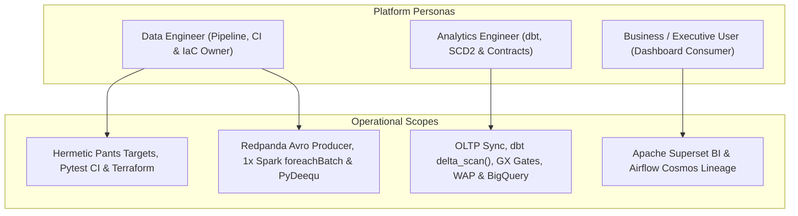

# E-Commerce Data Platform Requirements Specification

## 1. Executive Summary & Vision

The **E-Commerce Medallion Lakehouse & Real-Time Streaming Platform** (`projects/ecommerce`) provides unified operational and analytical intelligence over e-commerce clickstream and purchase activity while staying lightweight enough to run in production on low-cost single-node VMs (~2.5 GB RAM).

The platform bridges incremental event-time stream processing with ACID-compliant batch warehousing by pairing:
- A **Speed & Medallion Silver Layer** (Redpanda + Avro Schema Registry + single-consumer PySpark `foreachBatch` + ABRiS + live PyDeequ + Delta Lake Silver/DLQ) for exact tumbling-window and session KPIs.
- An **OLTP Dimension Sync Layer** (PostgreSQL 16 + `psycopg2-binary` + zero-Pandas PyArrow ZSTD export) for customer and product master data.
- A **Batch Warehouse Layer** (dbt `1.12` + DuckDB `1.5` native `delta_scan()`) for SCD Type 2 snapshots, contract-enforced incremental Gold marts, native dbt unit tests, and materialized monitor tables.
- A **Quality, WAP & Cloud Governance Layer** (Great Expectations over live Silver Delta + staging Gold, atomic `wap_duckdb.py` promotion, compacted GCS Parquet + partitioned BigQuery, Terraform IaC).
- An **Orchestration & Serving Layer** (Apache Airflow `2.9.3` + Astronomer Cosmos + Apache Superset `6.1.0` + Redis 7).

---

## 2. Platform Stakeholders & Functional Scopes

### 2.1 Data Engineer
- **Hermetic Execution & Testing**: Execute every pipeline entry point as a reproducible Pants [PEX](Glossary#pex) (`pex_binary`, `./pants run ...`) and run `./pants test ::` + `.github/workflows/ci.yml` against Python `3.10.9` and `3rdparty/user_reqs.lock`.
- **Low-Footprint Production Hosting**: Run the unified stack (`-f orchestration/docker-compose.yml -f orchestration/docker-compose.prod.yml`) on a ~2.5 GB RAM budget using single-binary Redpanda (`350 MB`, included from `projects/common/docker/docker-compose.yml`), [availableNow](Glossary#availablenow) Spark bursts, and Terraform-managed Free-Tier GCP resources (`infra/terraform/`).
- **Stream Governance**: Enforce [Avro](Glossary#avro) schema contracts in Redpanda [Schema Registry](Glossary#schema-registry) (`:8081`), run [PyDeequ](Glossary#pydeequ) inside [foreachBatch](Glossary#foreachbatch), and isolate malformed events in `quarantine_events` ([DLQ](Glossary#dlq)).

### 2.2 Analytics Engineer
- **ACID Lakehouse Scanning**: Read Delta tables via `get_delta_path` (`delta_scan(...)`) so overwrites and compaction never leak tombstoned Parquet files.
- **SCD Type 2 & Model Contracts**: Track historical dimension changes (`snap_customers`, `snap_products`), join purchase facts point-in-time, enforce dbt column contracts (`contract: {enforced: true}`), and verify SQL logic with `unit_tests.yml`.
- **Atomic WAP Isolation**: Execute dbt models and Great Expectations against `ecommerce_staging.duckdb` before promoting atomically to `ecommerce.duckdb`.

### 2.3 Business & Executive Stakeholder
- **Real-Time KPI Monitoring**: Inspect exact Total Revenue, Units Sold, Cumulative Users, and Average Conversion Rate at `http://localhost:8088` (with optional read-only public guest access via `SUPERSET_PUBLIC_READONLY=true`).
- **Pipeline Trust & DLQ Visibility**: Monitor `last_ingest`, `gx_quality_checks`, `pydeequ_quality_checks`, and `quarantine_summary` materialized directly inside `ecommerce.duckdb`.

---

## 3. Speed & Medallion Silver Layer Requirements (`streaming_layer/`)

### 3.1 Avro Schema Governance & Synthetic/File Event Producer
- **Producer (`ecommerce_producer.py`)**: Supports deterministic JSONL replay (`--mode file`) and realistic synthetic funnel traffic (`--mode synthetic` with `--count`, `--continuous`, `--rate`, `--late-event-ratio`, and `--anomaly-ratio`) serialized with `AvroSerializer` against `ecommerce_event.avsc` and Redpanda Schema Registry (`:8081`).
- **Consumer (`ecommerce_aggregation_job.py`)**: Connects once to `ecommerce_events`, deserializes Avro via `get_abris_from_avro_column` (ABRiS `6.4.0`), casts `event_time` to `TIMESTAMP`, and applies a `10 seconds` watermark.

### 3.2 Medallion Silver/DLQ & Stateful Aggregations (`aggregations.py`, `sinks.py`)
1. **Single-Pass Micro-Batch (`write_silver_and_quarantine_microbatch`)**: Caches each micro-batch once (`persist()`), runs live PyDeequ verification, routes valid rows to date-partitioned `silver_ecommerce_events`, and routes invalid rows to `quarantine_events` with `quarantine_reason`.
2. **8 Compacted KPI Delta Sinks (`materialize_kpi_sinks_from_silver`)**: Computes non-overlapping `10s` tumbling windows (`url_counts`, `user_counts`, `url_conversion`, `category_sales`, `product_sales`, `cart_metrics`, `top_urls_per_user`) and `15-minute` (`900s`) `session_funnels` in a single cached read over Silver.
3. **Execution Modes**: `--mode available-now` (incremental catch-up default), `--mode streaming` (continuous `30s` trigger), and `--mode batch`.

---

## 4. OLTP Dimension Sync Requirements (`oltp_sync/`)

- **Connection Pooling (`config.py`)**: Thread-safe `ThreadedConnectionPool` (`minconn=1`, `maxconn=5`) with commit/rollback context management (`get_connection()`).
- **Zero-Pandas PyArrow Export (`sync_dimensions.py`)**: Upserts `dim_customers` and `dim_products` in PostgreSQL 16 and exports typed ZSTD Parquet files directly via `pyarrow.Table.from_pydict` (no Pandas copy), supporting `--seed-from-defaults-on-offline` and `--simulate-scd-change`.

---

## 5. Batch Layer, WAP & Gold Warehouse Requirements (`batch_layer/`, `wap_duckdb.py`)

- **Engine**: DuckDB `1.5.6` with native `delta` extension pre-loaded via `profiles.yml`.
- **Staging Views (`models/staging/`)**: 9 Delta-backed views (`silver_ecommerce_events`, `quarantine_events`, `cart_metrics`, `category_sales`, `product_sales`, `session_funnels`, `top_urls_per_user`, `url_conversion`, `url_counts`) using `delta_scan()` + 2 Parquet dimension views (`dim_customers`, `dim_products`).
- **SCD Type 2 Snapshots (`snapshots/`)**: `snap_customers` and `snap_products`.
- **Gold Analytical Marts (`models/marts/`)**: 9 marts including incremental (`delete+insert`) time-series tables, SCD2 point-in-time enriched marts, enforced model contracts (`contract: {enforced: true}`), and native dbt `unit_tests.yml`.
- **Materialized Monitors (`models/monitors/`)**: `last_ingest`, `gx_quality_checks`, `pydeequ_quality_checks`, and `quarantine_summary` materialized as tables for atomic WAP promotion.

---

## 6. Data Quality, Cloud FinOps & IaC (`quality/`, `cloud_sync/`, `infra/terraform/`)

- **Spark Micro-Batch Quality (`quality_checks.py`)**: Live PyDeequ verification inside `foreachBatch` (gracefully handling empty batches), writing `pydeequ_checks.parquet` and `latest_report.json`.
- **Warehouse Quality (`quality/validate_ecommerce.py`)**: Great Expectations Fluent API validating live `silver_ecommerce_events` via DuckDB `delta_scan()`, asserting quarantine DLQ ratio $\le$ `--max-quarantine-ratio`, and validating staging Gold marts.
- **FinOps GCP Sync (`cloud_sync/export_to_gcp.py`) & Terraform (`infra/terraform/`)**: Exports 5 compacted ZSTD Gold Parquet files to GCS (7-day auto-expire lifecycle rule in Terraform), loads time-partitioned and clustered BigQuery tables directly from Parquet, and caps verification queries with `maximum_bytes_billed = 100 MB`.

---

## 7. Orchestration & Executive BI Requirements (`orchestration/`)

- **Astronomer Cosmos Airflow DAG (`ecommerce_batch_refresh`)**: Scheduled every 15 minutes (`*/15 * * * *`), optionally executing synthetic producer + Spark `availableNow` (`SPARK_IN_AIRFLOW=true`), then `DeltaStreamSensor` $\rightarrow$ `sync_postgres_dimensions` $\rightarrow$ `prepare_wap_staging_db` $\rightarrow$ Cosmos `DbtTaskGroup` (serialized on `duckdb_write_pool`) $\rightarrow$ `run_great_expectations` $\rightarrow$ `dbt_build_monitors` $\rightarrow$ `publish_wap_duckdb` $\rightarrow$ `sync_cloud_warehouse`.
- **Apache Superset BI (`superset/`)**: Declarative Dashboards-as-Code served over `duckdb-engine` (`read_only=True`, `pool_recycle=30s`, `pool_pre_ping=true`), Redis 7 caching, and optional public read-only guest mode.
