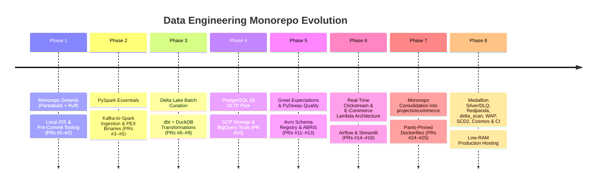

# Project History & Engineering Milestones

This document chronicles the major engineering phases, architectural evolutions, and pull requests across **`JayKay24/data-engineering`**, from initial Pantsbuild bootstrapping through full consolidation into the unified **`projects/ecommerce`** platform.

---

## 📅 Timeline Overview

---

## 🏛 Phase 1: Monorepo Genesis & Developer Tooling (PRs #1–#2)

- **Pantsbuild & Python `3.10.9`**: Bootstrapped the repository with Pants (`pants.toml`), `3rdparty/requirements.txt`, `3rdparty/user_reqs.lock`, `.python-version`, and `.venv` export workflow.
- **IDE & Agent Governance**: Configured local-only VS Code interpreter/debug settings (`.vscode/settings.json`, `.vscode/launch.json`) and established `agents.md` as the repository source of truth.
- **PR [#1](https://github.com/JayKay24/data-engineering/pull/1)–[#2](https://github.com/JayKay24/data-engineering/pull/2)**: Introduced Ruff formatting/linting via `.pre-commit-config.yaml` and initial CI PR automation (later superseded by local agent self-review in Phase 7).

---

## ⚙️ Phase 2: PySpark Essentials & Kafka Ingestion (PRs #3–#5)

- **Foundational Spark Patterns**: Built core PySpark batch scripts (`word_count.py`, `employee_partition_by_hire_date.py`) demonstrating DataFrame transformations and year/month Parquet partitioning.
- **PR [#3](https://github.com/JayKay24/data-engineering/pull/3)–[#5](https://github.com/JayKay24/data-engineering/pull/5)**: Implemented Kafka-to-Spark ingestion pipelines with `TypedDict` event contracts (`UserEvent`), line-by-line streaming producers, graceful error handling, and Pants `pex_binary` packaging targets.

---

## 🗄 Phase 3: Lakehouse Curation with Delta Lake, dbt & DuckDB (PRs #6–#9)

- **PR [#6](https://github.com/JayKay24/data-engineering/pull/6)**: Added PySpark batch transformation and Delta Lake curation (`purchases`, `customers`, `products` dimensional enrichment and quarterly aggregations) with explicit `StructType` schemas.
- **PR [#7](https://github.com/JayKay24/data-engineering/pull/7)–[#9](https://github.com/JayKay24/data-engineering/pull/9)**: Introduced containerized dbt + DuckDB SQL transformation models, standardized README tech stack shield badges, and enforced documentation synchronization rules.

---

## ☁️ Phase 4: Relational OLTP & Cloud Storage Integration (PR #10)

- **PR [#10](https://github.com/JayKay24/data-engineering/pull/10)**:
  - Built containerized PostgreSQL 16 storage with a thread-safe `ThreadedConnectionPool` singleton and transactional `get_connection()` context manager.
  - Added Google Cloud Storage (`google-cloud-storage`) and BigQuery (`google-cloud-bigquery`, `db-dtypes`, `pyarrow`) clients with bounded query limits.
  - Introduced `projects/common/logger.py` (`get_logger`) to standardize structured logging across the monorepo.

---

## 🛡️ Phase 5: Data Quality & Schema Governance (PRs #11–#13)

- **PR [#11](https://github.com/JayKay24/data-engineering/pull/11)–[#12](https://github.com/JayKay24/data-engineering/pull/12)**: Implemented automated Great Expectations Fluent API validation suites (`--fail-on-error` support) and distributed Apache Spark verification with Amazon PyDeequ.
- **PR [#13](https://github.com/JayKay24/data-engineering/pull/13)**: Replaced raw JSON Kafka ingestion with **Avro Schema Governance** powered by Confluent Schema Registry and **ABRiS** Py4J deserialization inside PySpark Structured Streaming.

---

## ⚡ Phase 6: E-Commerce Real-Time Lambda Architecture (PRs #14–#16)

- **PR [#14](https://github.com/JayKay24/data-engineering/pull/14)**: Centralized Kafka, Zookeeper, Schema Registry Docker Compose, and shared Avro/ABRiS helpers into `projects/common/`, and built the multi-metric PySpark + Delta Lake streaming aggregation engine.
- **PR [#15](https://github.com/JayKay24/data-engineering/pull/15)–[#16](https://github.com/JayKay24/data-engineering/pull/16)**: Launched the unified E-Commerce Lambda Architecture combining:
  - 7+ real-time streaming KPI sinks (`url_counts`, `user_counts`, `url_conversion`, `category_sales`, `cart_metrics`, `session_funnels`, `top_urls_per_user`).
  - dbt + DuckDB staging views (`get_stream_path` macro), analytical marts, `not_null` tests, and `last_ingest` freshness monitor.
  - Containerized Apache Airflow (`DeltaStreamSensor`) and interactive Streamlit + Plotly dashboard (`:8501`).

---

## 🚀 Phase 7: Monorepo Consolidation & Pants-Pinned Containers (PRs #24–#26+)

- **PR [#24](https://github.com/JayKay24/data-engineering/pull/24), [#25](https://github.com/JayKay24/data-engineering/pull/25)**:
  - Consolidated the entire repository around top-level **`projects/ecommerce/`** and **`projects/common/`**, retiring the standalone instructional sub-projects (`essentials`, `ingestion`, `transformation`, `storage`, `quality`) and removing unused `openpyxl` + CI AI reviewer scripts.
  - Folded every retained capability directly into the e-commerce platform: **PyDeequ** Spark checks (`quality_checks.py`), **PostgreSQL OLTP dimension sync** (`oltp_sync/`) with enriched dbt marts (`customer_segment_spending`, `brand_category_performance`), **Great Expectations** Gold warehouse suites (`quality/`), lock-resilient `connect_duckdb_readonly` snapshots (`duckdb_utils.py`), and optional **GCS/BigQuery sync** (`cloud_sync/`).
  - Enabled `pants.backend.docker` and rewrote all three Dockerfiles (`batch_layer`, `orchestration`, `viz`) to derive exact package pins and DuckDB CLI versions from `3rdparty/user_reqs.lock`, isolating Airflow's task runtime in `/opt/pipeline-venv`.
  - Expanded the Streamlit dashboard with **Customer & Brand Intelligence** and **Data Quality & Pipeline Health** tabs, and pinned `scipy<1.15.0` in `3rdparty/constraints.txt` for macOS `arm64` compatibility.
- **PR [#26](https://github.com/JayKay24/data-engineering/pull/26), [#28](https://github.com/JayKay24/data-engineering/pull/28) & Apache Superset BI Migration**:
  - Standardized Google-style docstrings, type hints, and inline comments across `oltp_sync/sync_dimensions.py`, `quality/validate_ecommerce.py`, and `cloud_sync/export_to_gcp.py`.
  - Brought the GitHub Wiki under version control in `docs/wiki/` with automated link/anchor/Mermaid validation (`docs/validate_wiki.py`) and GitHub Actions mirror synchronization (`.github/workflows/wiki-sync.yml`) to `data-engineering.wiki.git` on pushes to `develop` and `master`.
  - Replaced Streamlit & Plotly (`orchestration/viz/`) with **Apache Superset `6.1.0`** (`orchestration/superset/`) backed by shared PostgreSQL 16, Redis 7 caching, read-only `duckdb-engine`, flat Parquet quality monitor views (`gx_quality_checks`, `pydeequ_quality_checks`), and Git-versioned Dashboards-as-Code YAML assets.

---

## 🏗️ Phase 8: Production-Ready Medallion Modernization (`feat/production-medallion-modernization`)

- **Correctness & Medallion Lakehouse Refactor**:
  - Replaced the 8-query Kafka fan-out with a single cached `foreachBatch` Spark consumer writing date-partitioned `silver_ecommerce_events` and `quarantine_events` DLQ tables with live PyDeequ verification, and fixed 2x revenue double-counting by adopting non-overlapping `10s` tumbling windows.
  - Enabled DuckDB's native `delta` extension (`delta_scan()`) in `profiles.yml` and `get_stream_path.sql` so dbt never reads tombstoned Delta Parquet files, materialized `models/monitors/` as tables, and introduced `wap_duckdb.py` for atomic Write-Audit-Publish DuckDB promotion.
- **Cost & Memory Optimization**:
  - Replaced ZooKeeper + Confluent Kafka + Schema Registry with single-binary **Redpanda (`v24.2.11`, 350 MB RAM)**, added `--mode available-now` incremental Spark catch-up, refactored `oltp_sync` to zero-Pandas PyArrow ZSTD export, and introduced `orchestration/docker-compose.prod.yml` (<2.6 GB RAM) with optional `SUPERSET_PUBLIC_READONLY` and Cloudflare Tunnel (subsequently DRY-refactored via Compose `include:` and a lean prod override in `refactor/dry-docker-compose`).
- **Senior DE Capabilities, CI & IaC**:
  - Added dbt SCD Type 2 snapshots (`snap_customers`, `snap_products`), incremental (`delete+insert`) Gold marts with enforced Model Contracts (`contract: {enforced: true}`), and native dbt `unit_tests.yml`.
  - Integrated **Astronomer Cosmos** `DbtTaskGroup` serialized on `duckdb_write_pool`, updated `export_to_gcp.py` for compacted GCS uploads + partitioned/clustered BigQuery loads with a `100 MB` query guardrail, added `infra/terraform/` GCP IaC, and built a full `./pants test ::` Pytest suite wired into `.github/workflows/ci.yml`.
