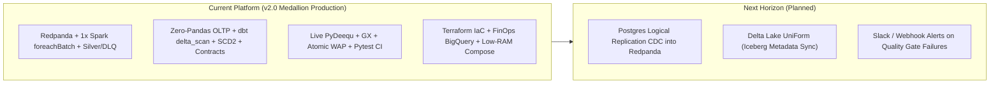

# Requirements Traceability Matrix & Platform Roadmap

## 1. Traceability Overview

This document provides end-to-end traceability mapping every platform requirement in **`JayKay24/data-engineering`** to its implementation files, Pants targets, and automated verification checks.

Status Definitions:

- **`Implemented`**: Built, integrated into `projects/ecommerce`, wired to Pants targets, and verified.
- **`Planned`**: Specified on the next-horizon roadmap.

---

## 2. Requirements Traceability Matrix

| Capability / Requirement                   |    Status     | Speed / OLTP / Cloud Implementation                                             | Batch / Orchestration / UI Implementation                               | Pants Target & Verification                                                                 |
| :----------------------------------------- | :-----------: | :------------------------------------------------------------------------------ | :---------------------------------------------------------------------- | :------------------------------------------------------------------------------------------ |
| **Hermetic Monorepo Build & Lockfile**     | `Implemented` | `pants.toml`, `3rdparty/requirements.txt`, `3rdparty/constraints.txt`           | `3rdparty/user_reqs.lock`, `3rdparty/extract_lock_constraints.py`       | `./pants generate-lockfiles`, `./pants peek ::`                                             |
| **Structured Logging Factory**             | `Implemented` | `projects/common/logger.py` (`get_logger`)                                      | Imported across all e-commerce modules                                  | `./pants lint projects/common::`                                                            |
| **Low-RAM Redpanda Broker & SR Stack**     | `Implemented` | `projects/common/docker/docker-compose.yml` (`:9092`, `:8081`, `350 MB` RAM)    | Included in `orchestration/docker-compose.yml` via Compose `include:`    | `docker compose -f projects/common/docker/docker-compose.yml up -d` or `make up`            |
| **Avro Contract & Synthetic Producer**     | `Implemented` | `ecommerce_event.avsc`, `ecommerce_producer.py` (`--mode file\|synthetic`)      | `projects/common/kafka_avro.py` (`create_avro_producer`)                | `test_generate_synthetic_events_deterministic_with_anomalies`                               |
| **Single-Pass `foreachBatch` Silver/DLQ**  | `Implemented` | `sinks.py` (`write_silver_and_quarantine_microbatch`), `aggregations.py`        | `silver_ecommerce_events` (date-partitioned) & `quarantine_events` DLQ  | `test_silver_quarantine_delta_roundtrip_with_duckdb_delta_scan`                             |
| **Exact Tumbling & Session KPIs**          | `Implemented` | `ecommerce_config.yml` (`10s` tumbling + `900s` session), `sinks.py`            | `available-now` (default), `streaming`, & `batch` modes                 | `test_tumbling_window_prevents_revenue_double_counting`                                     |
| **Live Micro-Batch PyDeequ Verification**  | `Implemented` | `streaming_layer/quality_checks.py` (`run_pydeequ_verification`)                | Runs inside `foreachBatch` & emits `pydeequ_checks.parquet`             | `./pants run projects/ecommerce/streaming_layer:quality_checks`                             |
| **Zero-Pandas PyArrow OLTP Sync**          | `Implemented` | `oltp_sync/sync_dimensions.py` (`pyarrow.Table.from_pydict` + ZSTD Parquet)     | Supports `--seed-from-defaults-on-offline` & `--simulate-scd-change`    | `test_oltp_sync_offline_and_scd_mutation`                                                   |
| **ACID DuckDB `delta_scan()` Staging**     | `Implemented` | `batch_layer/profiles.yml` (`extensions: [delta]`)                              | `batch_layer/macros/get_stream_path.sql` (`get_delta_path`)             | `test_delta_scan_ignores_tombstoned_parquet_files`                                          |
| **SCD2 Snapshots, Contracts & Unit Tests** | `Implemented` | `snapshots/snap_customers.sql`, `snap_products.sql`                             | Incremental `delete+insert` marts, `contract: {enforced: true}`, `unit_tests.yml` | `dbt test --select test_type:unit` & `dbt build`                                    |
| **Materialized Freshness & DLQ Monitors**  | `Implemented` | `last_ingest.sql`, `gx_quality_checks.sql`, `pydeequ_quality_checks.sql`        | `quarantine_summary.sql` (`materialized='table'` inside DuckDB)         | `dbt build -s 'path:models/monitors/**'`                                                    |
| **Atomic DuckDB WAP & Snapshot Reader**    | `Implemented` | `projects/ecommerce/wap_duckdb.py` (`prepare`/`publish`), `duckdb_utils.py`     | `CHECKPOINT;` + `os.replace()` isolating staging from Superset          | `test_wap_prepare_and_atomic_publish`                                                       |
| **Live Silver & Staging Gold GX Gate**     | `Implemented` | `quality/validate_ecommerce.py` (DuckDB `delta_scan` + DLQ ratio + Gold marts)  | Emits `gx_validation_results.json` & `gx_checks.parquet`                | `test_validate_ecommerce_pipeline_against_live_silver_and_gold`                             |
| **Compacted GCS & FinOps BigQuery Sync**   | `Implemented` | `cloud_sync/export_to_gcp.py` (ZSTD Gold Parquet + `TimePartitioning` + clustering) | `100 MB` `maximum_bytes_billed` guardrail + Terraform IaC               | `test_bigquery_load_config_finops_partitioning` & `test_cloud_sync_dry_run_with_duckdb`     |
| **Airflow + Astronomer Cosmos DAG**        | `Implemented` | `orchestration/dags/ecommerce_pipeline.py` (`SPARK_IN_AIRFLOW`, `DeltaStreamSensor`) | Cosmos `DbtTaskGroup` serialized via `duckdb_write_pool` (`slots=1`)    | `test_airflow_cosmos_dag_parses_cleanly`                                                    |
| **Apache Superset BI & Low-RAM Prod Stack**| `Implemented` | `superset_config.py` (`SUPERSET_PUBLIC_READONLY`), `pool_recycle=30s`           | `docker-compose.yml` + `docker-compose.prod.yml` override (~2.5 GB + `cloudflared`) | `test_superset_assets_validation_passes`                                         |
| **Terraform / OpenTofu GCP IaC**           | `Implemented` | `infra/terraform/` (`main.tf`, `variables.tf`, `outputs.tf`)                    | 7-day GCS lifecycle rule, partitioned BQ tables & least-privilege IAM   | `.github/workflows/ci.yml` (`terraform fmt -check` & `validate`)                            |
| **Automated CI (`pytest` + Ruff + dbt)**   | `Implemented` | `.github/workflows/ci.yml` + `projects/ecommerce/tests/`                        | Runs Ruff, `./pants test ::`, dbt unit tests, Superset, Wiki & Terraform| `./pants test ::` & `./pants lint ::`                                                       |

---

## 3. Platform Roadmap & Future Enhancements

### 3.1 PostgreSQL Logical Replication CDC Streaming
- **Description**: Stream live `dim_customers` and `dim_products` changes from PostgreSQL WAL (`wal_level=logical`) directly into Redpanda topics for real-time dimension enrichment.

### 3.2 Delta Lake UniForm (Iceberg Interoperability)
- **Description**: Enable `delta.universalFormat.enabledFormats = iceberg` on `silver_ecommerce_events` so external engines (BigQuery Omni, DuckDB Iceberg) can query tables seamlessly across formats.

### 3.3 Automated Quality Gate Alerting
- **Description**: Dispatch structured Slack or webhook alerts from Airflow `on_failure_callback` whenever PyDeequ, dbt contracts, or Great Expectations flags a threshold breach.
