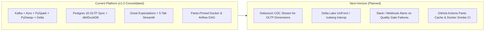

# Requirements Traceability Matrix & Platform Roadmap

## 1. Traceability Overview

This document provides end-to-end traceability mapping every platform requirement in **`JayKay24/data-engineering`** to its implementation files, Pants targets, and automated verification checks.

Status Definitions:

- **`Implemented`**: Built, integrated into `projects/ecommerce`, wired to Pants targets, and verified.
- **`Partial`**: Core backend/pipeline implementation complete; extended visualization or cloud automation optional.
- **`Planned`**: Specified on the next-horizon roadmap.

---

## 2. Requirements Traceability Matrix

| Capability / Requirement                   |    Status     | Speed / OLTP / Cloud Implementation                                             | Batch / Orchestration / UI Implementation                               | Pants Target & Verification                                                                 |
| :----------------------------------------- | :-----------: | :------------------------------------------------------------------------------ | :---------------------------------------------------------------------- | :------------------------------------------------------------------------------------------ |
| **Hermetic Monorepo Build & Lockfile**     | `Implemented` | `pants.toml`, `3rdparty/requirements.txt`, `3rdparty/constraints.txt`           | `3rdparty/user_reqs.lock`, `3rdparty/extract_lock_constraints.py`       | `./pants generate-lockfiles`, `./pants peek ::`                                             |
| **Structured Logging Factory**             | `Implemented` | `projects/common/logger.py` (`get_logger`)                                      | Imported across all e-commerce modules                                  | `./pants lint projects/common::`                                                            |
| **Kafka + Schema Registry Stack**          | `Implemented` | `projects/common/docker/docker-compose.yml` (`:9092`, `:8081`)                  | Health-checked Zookeeper, Kafka, Schema Registry                        | `docker compose -f projects/common/docker/docker-compose.yml up -d`                         |
| **Avro Schema Contract & Producer**        | `Implemented` | `streaming_layer/schemas/ecommerce_event.avsc`, `ecommerce_producer.py`         | `projects/common/kafka_avro.py` (`create_avro_producer`)                | `./pants package projects/ecommerce/streaming_layer:producer`                               |
| **ABRiS Py4J Avro Deserialization**        | `Implemented` | `projects/common/kafka_avro.py` (`get_abris_from_avro_column`)                  | `streaming_layer/aggregations.py` (`build_parsed_stream`)               | `./pants package projects/ecommerce/streaming_layer:stream_job`                             |
| **Watermarked Sliding Window KPIs**        | `Implemented` | `aggregations.py` (`url_counts`, `user_counts`, `category_sales`)               | `batch_layer/models/staging/*.sql`                                      | `./pants run projects/ecommerce/streaming_layer:stream_job -- --batch`                      |
| **Conversion & Cart Abandonment KPIs**     | `Implemented` | `aggregations.py` (`aggregate_url_conversion`, `aggregate_cart_metrics`)        | `batch_layer/models/marts/daily_url_conversion.sql`, `viz/app.py`       | `dbt test` (`not_null`), GX `gold_daily_url_conversion_suite`                               |
| **15-Min Session Funnel Analytics**        | `Implemented` | `aggregations.py` (`aggregate_session_funnels`, 900s gap)                       | `batch_layer/models/staging/session_funnels.sql`                        | `models/staging/schema.yml` (`not_null` on `user_id`, `session_start`)                      |
| **Granular Product Sales Sink**            | `Implemented` | `aggregations.py` (`aggregate_product_sales` with `user_id`, `product_id`)      | `batch_layer/models/staging/product_sales.sql`                          | `models/staging/schema.yml` (`not_null` on `user_id`, `product_id`, `revenue`)              |
| **Delta Lake ACID Sinks & Checkpoints**    | `Implemented` | `streaming_layer/sinks.py` (`write_streaming_sinks`, `write_batch_sinks`)       | `output_data/<sink>/`, `checkpoints/delta_<sink>/`                      | `./pants run projects/ecommerce/streaming_layer:stream_job -- --sink delta`                 |
| **PyDeequ Spark Quality Verification**     | `Implemented` | `streaming_layer/quality_checks.py` (`run_pydeequ_verification`)                | `output_data/pydeequ_metrics/latest_report.json`, Streamlit Tab 5       | `source .env && ./pants run projects/ecommerce/streaming_layer:quality_checks`              |
| **PostgreSQL OLTP Connection Pool**        | `Implemented` | `oltp_sync/config.py` (`ThreadedConnectionPool`, `get_connection`)              | `orchestration/docker-compose.yml` (`postgres:16-alpine`)               | `./pants package projects/ecommerce/oltp_sync:sync_dimensions`                              |
| **OLTP Dimension Sync & Offline Fallback** | `Implemented` | `oltp_sync/sync_dimensions.py` (`dim_customers`, `dim_products` to Parquet)     | Airflow `sync_postgres_dimensions` task                                 | `./pants run projects/ecommerce/oltp_sync:sync_dimensions -- --seed-from-defaults-on-offline`|
| **Dynamic dbt Parquet Path Macro**         | `Implemented` | `CLICK_STREAM_OUTPUT_PREFIX` env var                                            | `batch_layer/macros/get_stream_path.sql`                                | `.venv/bin/dbt parse --project-dir projects/ecommerce/batch_layer`                          |
| **User Cohort & Retention Marts**          | `Implemented` | `top_urls_per_user` stream sink                                                 | `cumulative_users.sql`, `new_vs_returning_users.sql`, `daily_top_urls_per_user.sql` | `dbt build` & Streamlit Tab 3 (`User Growth`)                                     |
| **OLTP-Enriched Dimensional Marts**        | `Implemented` | `product_sales` + `dim_customers` + `dim_products`                              | `customer_segment_spending.sql`, `brand_category_performance.sql`       | `models/marts/schema.yml` (`not_null`), GX `gold_customer_segment_spending_suite`           |
| **Pipeline Latency Freshness Monitor**     | `Implemented` | `url_counts` stream `window_end`                                                | `batch_layer/models/monitors/last_ingest.sql`, Streamlit Tab 5          | `dbt build` & Streamlit Freshness Monitor table                                             |
| **Lock-Resilient DuckDB Snapshot Reader**  | `Implemented` | `projects/ecommerce/duckdb_utils.py` (`connect_duckdb_readonly`)                | Used by `quality/validate_ecommerce.py` & `cloud_sync/export_to_gcp.py` | Verified under active DBeaver file lock (`./pants run projects/ecommerce/quality:validate`) |
| **Great Expectations Quality Gate**        | `Implemented` | `quality/validate_ecommerce.py` (raw JSON + Gold DuckDB suites)                 | `output_data/quality_reports/gx_validation_results.json`, Airflow Task 6 | `./pants run projects/ecommerce/quality:validate -- --fail-on-error`                        |
| **Optional GCS & BigQuery Lakehouse Sync** | `Implemented` | `cloud_sync/config.py`, `cloud_sync/export_to_gcp.py` (`GCP_SYNC_ENABLED`)      | Airflow `sync_cloud_warehouse` task (`--dry-run` default locally)       | `./pants run projects/ecommerce/cloud_sync:export`                                          |
| **Event-Driven Airflow Orchestration**     | `Implemented` | `DeltaStreamSensor` (`min_ready_tables=3`, `reschedule`)                        | `orchestration/dags/ecommerce_pipeline.py` (7-task DAG)                 | `.venv/bin/python` DAG import check (`7 tasks`)                                             |
| **Executive 5-Tab Streamlit Dashboard**    | `Implemented` | Cached DuckDB queries (`ttl=15`) + PyDeequ/GX JSON report readers               | `orchestration/viz/app.py` (`:8501`)                                    | `./pants package projects/ecommerce/orchestration/viz:app`                                  |
| **Lockfile-Pinned Container Builds**       | `Implemented` | `3rdparty/extract_lock_constraints.py` + `pants.backend.docker`                 | `batch_layer/Dockerfile`, `orchestration/Dockerfile`, `viz/Dockerfile`  | `projects/ecommerce/batch_layer:dbt_image`, `orchestration:airflow_image`, `viz:viz_image`  |
| **Automated Static Lint & Format Gates**   | `Implemented` | `.pre-commit-config.yaml` (`pants-fmt`, `pants-lint`)                           | Ruff linter & formatter configured in `pants.toml`                      | `./pants fmt :: && ./pants lint ::`                                                         |

---

## 3. Platform Roadmap & Future Enhancements

### 3.1 Debezium CDC Streaming for OLTP Dimensions
- **Description**: Replace scheduled 15-minute `sync_dimensions.py` batch snapshots with a Debezium PostgreSQL CDC connector streaming `dim_customers` and `dim_products` changes into Kafka.
- **Current State**: PostgreSQL dimensions sync cleanly on every Airflow run via `psycopg2` and `pyarrow`.
- **Roadmap Target**: Real-time stream-to-stream or stream-to-Delta enrichment in PySpark.

### 3.2 Delta Lake UniForm (Iceberg Compatibility)
- **Description**: Enable Delta Lake Universal Format (`delta.universalFormat.enabledFormats = iceberg`) on curated Delta tables so external engines (BigQuery Omni, DuckDB Iceberg extension) can query tables directly without intermediate Parquet copies.
- **Current State**: DuckDB reads Delta-backed Parquet files via `get_stream_path`.
- **Roadmap Target**: Native ACID snapshot isolation in DuckDB and BigQuery external tables.

### 3.3 Automated Quality Gate Alerting
- **Description**: Dispatch structured Slack or email alerts from Airflow `on_failure_callback` whenever PyDeequ or Great Expectations fails an expectation suite.
- **Current State**: Reports are persisted to JSON (`gx_validation_results.json`, `latest_report.json`) and rendered in Streamlit Tab 5.
- **Roadmap Target**: Real-time incident alerting with failing column/constraint payloads.

### 3.4 CI Pipeline for Pants & Container Verification
- **Description**: Add a lightweight GitHub Actions workflow running `./pants fmt --check ::`, `./pants lint ::`, and `./pants package` smoke builds on PRs targeting `develop` and `master`.
- **Current State**: Verified locally via agent self-review and `pre-commit` hooks per `agents.md`.
- **Roadmap Target**: Reproducible remote CI status checks on every PR.
