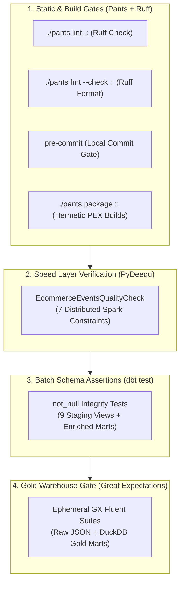
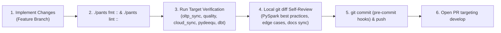

# Testing Strategy & Quality Gates

## 1. Overview & Quality Philosophy

The platform enforces a **4-Tier Quality & Verification Pyramid** spanning static build/lint checks, distributed Spark data quality constraints, warehouse SQL integrity assertions, and Gold analytical expectation suites.



---

## 2. The 4-Tier Verification Pyramid

### 2.1 Tier 1: Static Code, Dependency & Packaging Gates

Every Python module and Pants `BUILD` target is validated deterministically without external services:
- **Ruff Linting & Formatting**: Configured in `pants.toml` (`pants.backend.experimental.python.lint.ruff.check` & `ruff.format`).
- **Pre-Commit Enforcement**: `.pre-commit-config.yaml` triggers `./pants fmt` and `./pants lint` automatically on staged Python files before every commit.
- **Pants Dependency Inference & PEX Packaging**: Verifies all imports resolve cleanly against `3rdparty/user_reqs.lock` and builds self-contained PEX executables (`producer`, `stream_job`, `quality_checks`, `sync_dimensions`, `validate`, `export`, `package_assets`, `validate_wiki`).

```bash
./pants fmt ::
./pants lint ::
./pants peek ::
./pants package \
  projects/ecommerce/streaming_layer:producer \
  projects/ecommerce/streaming_layer:stream_job \
  projects/ecommerce/streaming_layer:quality_checks \
  projects/ecommerce/oltp_sync:sync_dimensions \
  projects/ecommerce/quality:validate \
  projects/ecommerce/cloud_sync:export \
  projects/ecommerce/orchestration/superset:package_assets \
  docs:validate_wiki
```

---

### 2.2 Tier 2: Distributed Spark Data Quality (`PyDeequ`)

Executed in `projects/ecommerce/streaming_layer/quality_checks.py` (`SPARK_VERSION=3.5`, Amazon Deequ `com.amazon.deequ:deequ:2.0.21-spark-3.5`):

- **Constraints (`EcommerceEventsQualityCheck`)**:
  1. `hasSize(lambda x: x > 0)`
  2. `isComplete("user_id")`
  3. `isComplete("url")`
  4. `isComplete("event_type")`
  5. `isComplete("event_time")`
  6. `isContainedIn("event_type", ["view", "add_to_cart", "purchase"])`
  7. `isNonNegative("price")`
- **Artifact**: Writes structured JSON summary (`latest_report.json`) and flat Parquet table (`pydeequ_checks.parquet`) under `projects/ecommerce/output_data/pydeequ_metrics/` (exposed via `models/monitors/pydeequ_quality_checks.sql` in Apache Superset).
- **Execution**:
  ```bash
  source .env && ./pants run projects/ecommerce/streaming_layer:quality_checks
  # Also runs automatically during batch pipeline execution:
  source .env && ./pants run projects/ecommerce/streaming_layer:stream_job -- --batch --sink delta
  ```

---

### 2.3 Tier 3: Warehouse SQL & Schema Integrity (`dbt test`)

Configured across `models/staging/schema.yml` and `models/marts/schema.yml`:

- Validates `not_null` constraints on critical business keys and metrics across staging views (`cart_metrics`, `category_sales`, `dim_customers`, `dim_products`, `product_sales`, `session_funnels`, `top_urls_per_user`, `url_conversion`, `url_counts`) and OLTP-enriched marts (`customer_segment_spending`, `brand_category_performance`).
- **Execution**:
  ```bash
  .venv/bin/dbt parse --project-dir projects/ecommerce/batch_layer --profiles-dir projects/ecommerce/batch_layer
  # Or inside the batch container:
  cd projects/ecommerce/batch_layer && make dbt-build
  ```

---

### 2.4 Tier 4: Batch & Gold Warehouse Validation (`Great Expectations`)

Executed in `projects/ecommerce/quality/validate_ecommerce.py` using an ephemeral Great Expectations Fluent API context (`gx.get_context(mode="ephemeral")`):

- **Raw Event Feed Suite (`ecommerce_raw_events_suite`)**: Validates `user_id`, `url`, `event_type`, `event_time` completeness and allowed `event_type` values (`["view", "add_to_cart", "purchase"]`).
- **Gold Warehouse Suites (`ecommerce.duckdb`)**:
  - `gold_daily_category_sales_suite`: `category` not null; `daily_revenue >= 0`; `daily_units >= 0`.
  - `gold_daily_url_conversion_suite`: `url` not null; `0.0 <= avg_conversion_rate <= 1.0`.
  - `gold_customer_segment_spending_suite`: `user_id`, `segment` not null; `total_revenue >= 0`.
- **Lock-Safe Access**: Reads DuckDB via `connect_duckdb_readonly`, automatically falling back to a temporary snapshot if another process holds a lock.
- **Artifact**: Saves structured results to `output_data/quality_reports/gx_validation_results.json` and `output_data/quality_reports/gx_checks.parquet` (exposed via `models/monitors/gx_quality_checks.sql` in Apache Superset).
- **Execution**:
  ```bash
  ./pants run projects/ecommerce/quality:validate -- --fail-on-error
  ```

---

## 3. Standalone CLI & Local Self-Review Workflow

Per `agents.md`, every change undergoes a structured local self-review and verification pass prior to committing and opening a PR against `develop`:


