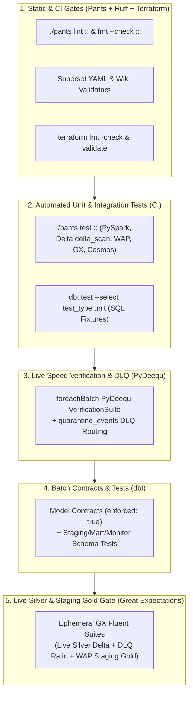
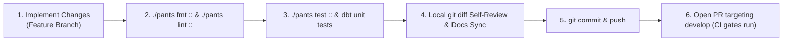

# Testing Strategy & Quality Gates

## 1. Overview & Quality Philosophy

The platform enforces a **5-Tier Quality & Verification Pyramid** spanning static build/lint checks, automated hermetic `pytest` + dbt unit tests in CI, live Spark micro-batch verification with DLQ routing, dbt schema/contract assertions, and live Great Expectations gates prior to atomic WAP promotion.



---

## 2. The 5-Tier Verification Pyramid

### 2.1 Tier 1: Static Code, Assets, Wiki & Infrastructure Gates

Executed locally via `.pre-commit-config.yaml` and remotely in `.github/workflows/ci.yml`:
```bash
./pants fmt ::
./pants lint ::
./pants run projects/ecommerce/orchestration/superset:package_assets
./pants run docs:validate_wiki
terraform -chdir=infra/terraform fmt -check -recursive
```

---

### 2.2 Tier 2: Hermetic `pytest` & `dbt` Unit Tests

1. **Pants `pytest` Suite (`projects/ecommerce/tests/`)**:
   - `test_aggregations.py`: Local Spark + Delta Lake session verifying `split_valid_and_quarantine_events`, exact non-doubled 10s tumbling sums, session funnels, and Spark Delta $\leftrightarrow$ DuckDB `delta_scan()` compatibility (including empty-quarantine initialization).
   - `test_wap_and_duckdb.py`: Verifies `prepare_staging_db` / `publish_staging_db` isolation and atomic swap, plus `delta_scan()` ignoring tombstoned Parquet files across overwrites.
   - `test_oltp_and_quality.py`: Verifies zero-Pandas PyArrow OLTP offline export, `--simulate-scd-change`, and Great Expectations validation against live Silver Delta & Gold DuckDB tables.
   - `test_orchestration_and_assets.py`: Verifies deterministic synthetic producer anomalies, Superset YAML validation, BigQuery FinOps partitioning/clustering configs, dry-run cloud sync, `DeltaStreamSensor`, and Airflow + Astronomer Cosmos `DbtTaskGroup` DAG parsing.
   ```bash
   source .env && ./pants test ::
   ```
2. **Native dbt `1.12` SQL Unit Tests (`projects/ecommerce/batch_layer/models/marts/unit_tests.yml`)**:
   - Verifies `daily_category_sales` exact summing, `daily_url_conversion` zero-view division safety, and `customer_segment_spending` point-in-time SCD Type 2 joins without requiring pre-existing tables.
   ```bash
   cd projects/ecommerce/batch_layer && ../../../.venv/bin/dbt test --select test_type:unit
   ```

---

### 2.3 Tier 3: Live Micro-Batch Spark Verification (`PyDeequ` + DLQ)

Executed inside `foreachBatch` (`write_silver_and_quarantine_microbatch`) as well as standalone (`projects/ecommerce/streaming_layer:quality_checks`):
- Evaluates `hasSize > 0`, completeness (`user_id`, `url`, `event_type`, `event_time`), `isContainedIn("event_type", ["view", "add_to_cart", "purchase"])`, and `isNonNegative("price")`.
- Persists `latest_report.json` and `pydeequ_checks.parquet` under `output_data/pydeequ_metrics/` (safe on empty batches).
- Routes invalid records to `quarantine_events` Delta DLQ so clean events proceed uninterrupted into `silver_ecommerce_events`.

---

### 2.4 Tier 4: Warehouse Contracts & Schema Integrity (`dbt`)

Configured across `models/staging/schema.yml`, `models/marts/schema.yml`, and `models/monitors/schema.yml`:
- Enforces dbt **Model Contracts** (`contract: {enforced: true}`) with explicit DuckDB column `data_type`s (`date`, `varchar`, `double`, `bigint`) on core Gold marts.
- Validates `not_null` and `accepted_values` tests across staging views, SCD2-enriched marts, and monitor tables.

---

### 2.5 Tier 5: Live Silver & WAP Staging Gold Gate (`Great Expectations`)

Executed in `projects/ecommerce/quality/validate_ecommerce.py`:
- **Live Silver Suite (`ecommerce_silver_events_suite`)**: Queries `silver_ecommerce_events` via DuckDB `delta_scan()` (with `--fallback-json` support for offline smoke runs).
- **Quarantine DLQ Ratio Gate (`quarantine_dlq_threshold_suite`)**: Ensures quarantined rows do not exceed `--max-quarantine-ratio` (default `0.5`).
- **Gold Staging Suites**: Validates `daily_category_sales`, `daily_url_conversion`, `customer_segment_spending`, and `brand_category_performance` inside `ecommerce_staging.duckdb` **before** `wap_duckdb.py publish` promotes the database to serving.

---

## 3. Standalone CLI & Local Self-Review Workflow


