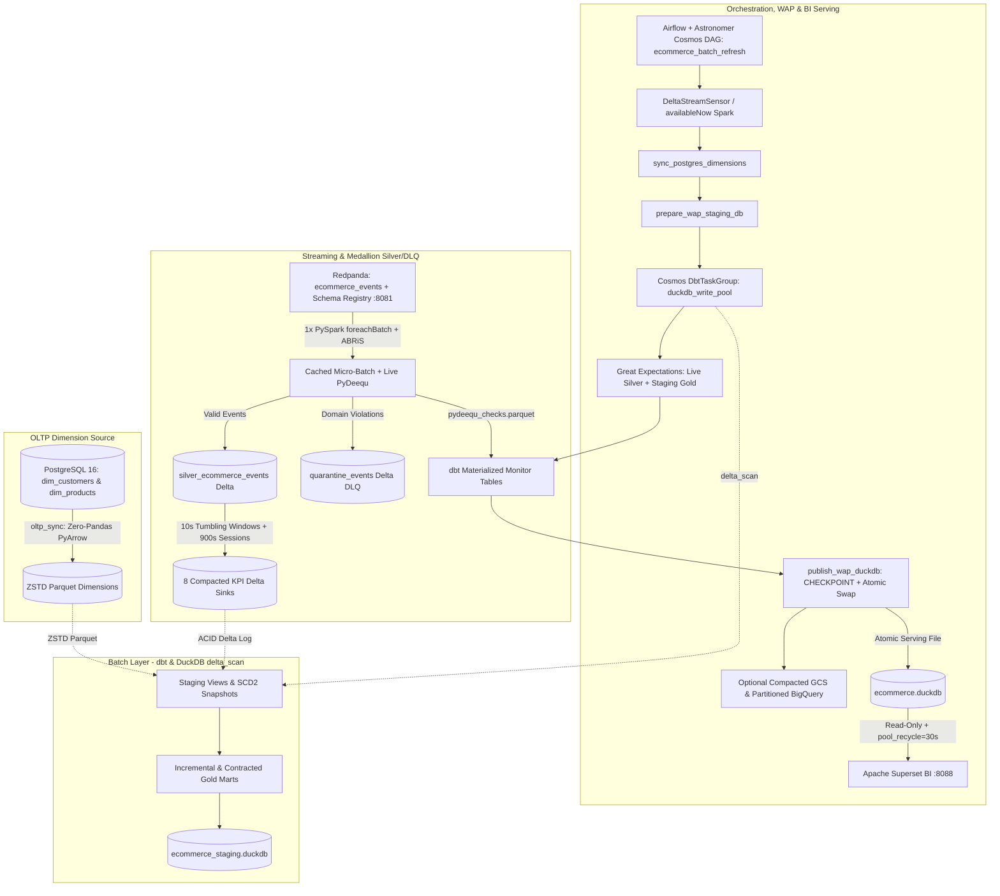

# E-Commerce Medallion Lakehouse & Real-Time Streaming Platform

This project implements a production-oriented **Medallion Lakehouse (Bronze/Kafka $\rightarrow$ Silver/DLQ $\rightarrow$ Gold)** for e-commerce intelligence, combining low-footprint **Redpanda** (Kafka + Schema Registry), single-consumer PySpark `foreachBatch` ingestion with live **PyDeequ** checks and quarantine routing, **PostgreSQL** OLTP dimensional sync, **dbt + DuckDB `delta_scan()`** (with SCD Type 2 snapshots, incremental contracted marts, and native dbt unit tests), **Great Expectations**, atomic **Write-Audit-Publish (WAP)** DuckDB promotion, FinOps **BigQuery** sync, and **Apache Airflow + Astronomer Cosmos** orchestrating **Apache Superset** executive BI dashboards.



---

## 📁 Project Architecture & Components

*   [projects/common/docker/docker-compose.yml](../common/docker/docker-compose.yml): Single-binary **Redpanda** broker (`:9092` Kafka API, `:8081` Confluent-compatible Schema Registry, ~350 MB RAM).

### 1. Speed & Medallion Silver Layer (`streaming_layer/`)
*   [config/ecommerce_config.yml](streaming_layer/config/ecommerce_config.yml): Configuration defining Kafka topics, Schema Registry URL, non-overlapping `10s` tumbling windows, `10s` watermark, `30s` continuous trigger, and `silver_ecommerce_events` / `quarantine_events` Delta targets.
*   [schemas/ecommerce_event.avsc](streaming_layer/schemas/ecommerce_event.avsc): Avro schema contract supporting `user_id`, `url`, `event_type`, `product_id`, `category`, `price`, and device headers.
*   [aggregations.py](streaming_layer/aggregations.py): Validated Silver/Quarantine DLQ splitter (`split_valid_and_quarantine_events`) and exact tumbling-window/session KPI aggregations (`url_counts`, `user_counts`, `url_conversion`, `category_sales`, `product_sales`, `cart_metrics`, `session_funnels`, `top_urls_per_user`).
*   [quality_checks.py](streaming_layer/quality_checks.py): Distributed Spark data quality checks with Amazon PyDeequ executed inside `foreachBatch` micro-batches and standalone CLI (`projects/ecommerce/streaming_layer:quality_checks`).
*   [sinks.py](streaming_layer/sinks.py): Single-pass `foreachBatch` Silver/DLQ persistence (`write_silver_and_quarantine_microbatch`) and cached Silver-to-KPI rollup (`materialize_kpi_sinks_from_silver`).
*   [ecommerce_producer.py](streaming_layer/ecommerce_producer.py): Avro event producer supporting deterministic JSONL replay (`--mode file`) and synthetic session/late-event/anomaly traffic (`--mode synthetic`) (`projects/ecommerce/streaming_layer:producer`).
*   [ecommerce_aggregation_job.py](streaming_layer/ecommerce_aggregation_job.py): PySpark orchestrator supporting `--mode available-now` (incremental catch-up default), `--mode streaming`, and `--mode batch` (`projects/ecommerce/streaming_layer:stream_job`).

### 2. OLTP Dimension Sync (`oltp_sync/`)
*   [config.py](oltp_sync/config.py): Thread-safe PostgreSQL connection pool (`psycopg2-binary`).
*   [sync_dimensions.py](oltp_sync/sync_dimensions.py): Seeds `dim_customers` and `dim_products` in PostgreSQL and exports typed ZSTD Parquet snapshots directly via PyArrow (zero intermediate Pandas copies, plus `--simulate-scd-change` for SCD Type 2 testing) (`projects/ecommerce/oltp_sync:sync_dimensions`).

### 3. Batch Layer (`batch_layer/`)
*   [dbt_project.yml](batch_layer/dbt_project.yml) & [profiles.yml](batch_layer/profiles.yml): dbt configuration targeting DuckDB with the native `delta` extension loaded.
*   [Dockerfile](batch_layer/Dockerfile) & [BUILD](batch_layer/BUILD): Lockfile-pinned dbt + DuckDB CLI container with pre-installed `delta` extension.
*   [Makefile](batch_layer/Makefile): Shortcuts for dbt execution (`make dbt-build`, `make query`).
*   [macros/get_stream_path.sql](batch_layer/macros/get_stream_path.sql): ACID `get_delta_path` (`delta_scan(...)`) and `get_parquet_path` (`read_parquet(...)`) macros.
*   [models/staging/](batch_layer/models/staging/): Staging views over Delta Lake tables (`delta_scan()`), `silver_ecommerce_events`, `quarantine_events`, and OLTP dimensions with `not_null` and `accepted_values` tests.
*   [snapshots/](batch_layer/snapshots/): SCD Type 2 historical tracking (`snap_customers.sql`, `snap_products.sql`) with `strategy='check'` and hard-delete invalidation.
*   [models/marts/](batch_layer/models/marts/): Incremental (`delete+insert`), contract-enforced (`contract: {enforced: true}`), and point-in-time SCD2-enriched analytical marts plus native dbt `unit_tests.yml`.
*   [models/monitors/](batch_layer/models/monitors/): Materialized monitor tables (`last_ingest.sql`, `gx_quality_checks.sql`, `pydeequ_quality_checks.sql`, `quarantine_summary.sql`) safe for atomic WAP promotion.

### 4. Data Quality Gate (`quality/`) & Atomic WAP (`wap_duckdb.py`)
*   [validate_ecommerce.py](quality/validate_ecommerce.py): Great Expectations validation suites reading live `silver_ecommerce_events` via DuckDB `delta_scan()`, checking `quarantine_events` DLQ ratios, and validating Gold marts (`projects/ecommerce/quality:validate`).
*   [wap_duckdb.py](wap_duckdb.py): Atomic Write-Audit-Publish CLI (`prepare` and `publish`) isolating dbt/GX writes in `ecommerce_staging.duckdb` before `CHECKPOINT` + `os.replace()` promotion (`projects/ecommerce:wap_duckdb`).

### 5. Cloud Sync (`cloud_sync/`)
*   [config.py](cloud_sync/config.py) & [export_to_gcp.py](cloud_sync/export_to_gcp.py): Optional GCP sync exporting compacted ZSTD Gold Parquet snapshots to GCS (`ecommerce/gold/*.parquet`) and loading time-partitioned, clustered BigQuery tables with a `100 MB` `maximum_bytes_billed` FinOps guardrail (`projects/ecommerce/cloud_sync:export`).

### 6. Orchestration & Serving Layer (`orchestration/`)
*   [docker-compose.yml](orchestration/docker-compose.yml) & [docker-compose.prod.yml](orchestration/docker-compose.prod.yml): Standard dev orchestration stack plus a unified low-RAM (<2.6 GB) production Compose stack bundling Redpanda, tuned Postgres 16, Redis 7, Airflow + Java 17/Spark, Superset 6.1.0, and optional Cloudflare Tunnel.
*   [Dockerfile](orchestration/Dockerfile) & [superset/Dockerfile](orchestration/superset/Dockerfile): Lockfile-pinned containers deriving package constraints from `3rdparty/user_reqs.lock`.
*   [dags/ecommerce_pipeline.py](orchestration/dags/ecommerce_pipeline.py): Airflow DAG combining optional `availableNow` Spark ingestion, `DeltaStreamSensor`, OLTP sync, atomic WAP prep, **Astronomer Cosmos** `DbtTaskGroup` (serialized on `duckdb_write_pool`), Great Expectations gate, materialized monitors, atomic WAP publish, and FinOps GCP sync.
*   [superset/](orchestration/superset/): Declarative **Dashboards-as-Code** YAML bundle (`assets/`), `pool_recycle=30s` WAP-friendly DuckDB engine config, optional `SUPERSET_PUBLIC_READONLY` guest mode (`superset_config.py`), and Pants validator/packager (`package_assets.py`).

---

## 🚀 Quickstart & Execution

### 1. Start Lightweight Redpanda Infrastructure
```bash
docker compose -f projects/common/docker/docker-compose.yml up -d
```

### 2. Stream E-Commerce Events to Redpanda
```bash
# Replay deterministic sample file
./pants run projects/ecommerce/streaming_layer:producer

# Or generate synthetic traffic with late events and controlled DLQ anomalies
./pants run projects/ecommerce/streaming_layer:producer -- --mode synthetic --count 50 --anomaly-ratio 0.1
```

### 3. Run the Medallion Spark Ingestion & KPI Rollup
```bash
# Incremental catch-up mode (processes all new offsets, runs PyDeequ + Silver/DLQ, exits cleanly)
./pants run projects/ecommerce/streaming_layer:stream_job -- --mode available-now --sink delta

# Continuous streaming mode
./pants run projects/ecommerce/streaming_layer:stream_job -- --mode streaming --sink delta
```

### 4. Run OLTP Sync, WAP, Quality Checks, or Cloud Sync via Pants
```bash
./pants run projects/ecommerce/oltp_sync:sync_dimensions -- --seed-from-defaults-on-offline
./pants run projects/ecommerce:wap_duckdb -- prepare
./pants run projects/ecommerce/quality:validate -- --fail-on-error
./pants run projects/ecommerce:wap_duckdb -- publish
./pants run projects/ecommerce/cloud_sync:export
```

### 5. Run Automated Tests (`pytest` + `dbt` Unit Tests)
```bash
./pants test ::
cd projects/ecommerce/batch_layer && ../../../.venv/bin/dbt test --select test_type:unit
```

### 6. Launch Orchestration & Dashboard Cluster
> **Prerequisite:** Ensure `AIRFLOW_FERNET_KEY` is present in your local `.env` file (e.g. `AIRFLOW_FERNET_KEY=IOYiXlIcJ8QVhBT2iVyuKc2ehyX7OcBt-_f1EPDyNqM=`).

```bash
cd projects/ecommerce/orchestration
make build  # Builds lockfile-pinned Airflow & Superset container images
make up     # Starts Airflow, Postgres, Redis, and Superset in background
make status # Checks container health status

# Or launch the unified low-RAM production stack (includes Redpanda + availableNow Spark):
make prod-up
```
- **Airflow Webserver UI:** `http://localhost:8080` (`admin` / `admin`)
- **Apache Superset BI:** `http://localhost:8088` (`admin` / `admin`, or public read-only when `SUPERSET_PUBLIC_READONLY=true`)

To stop orchestration services:
```bash
make down      # or make prod-down
```
